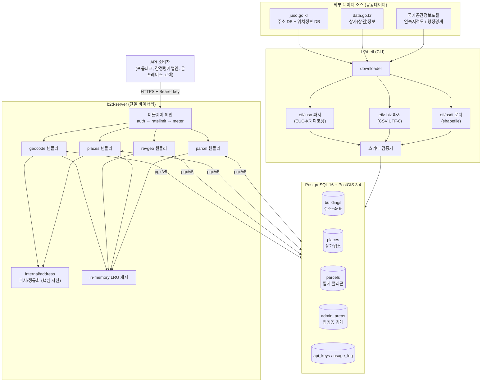
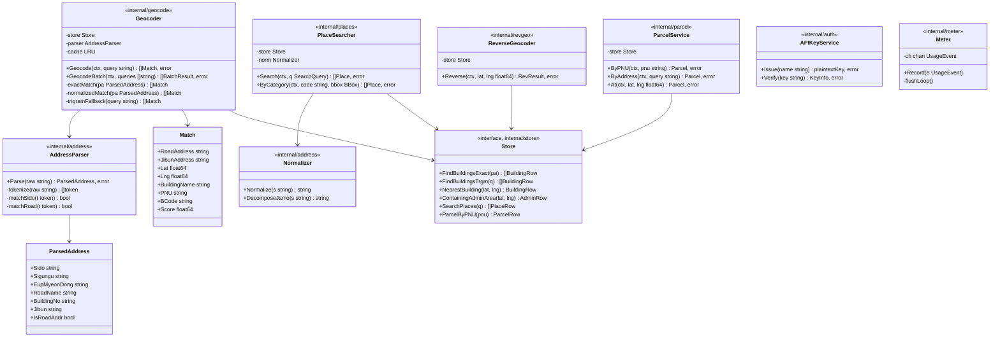
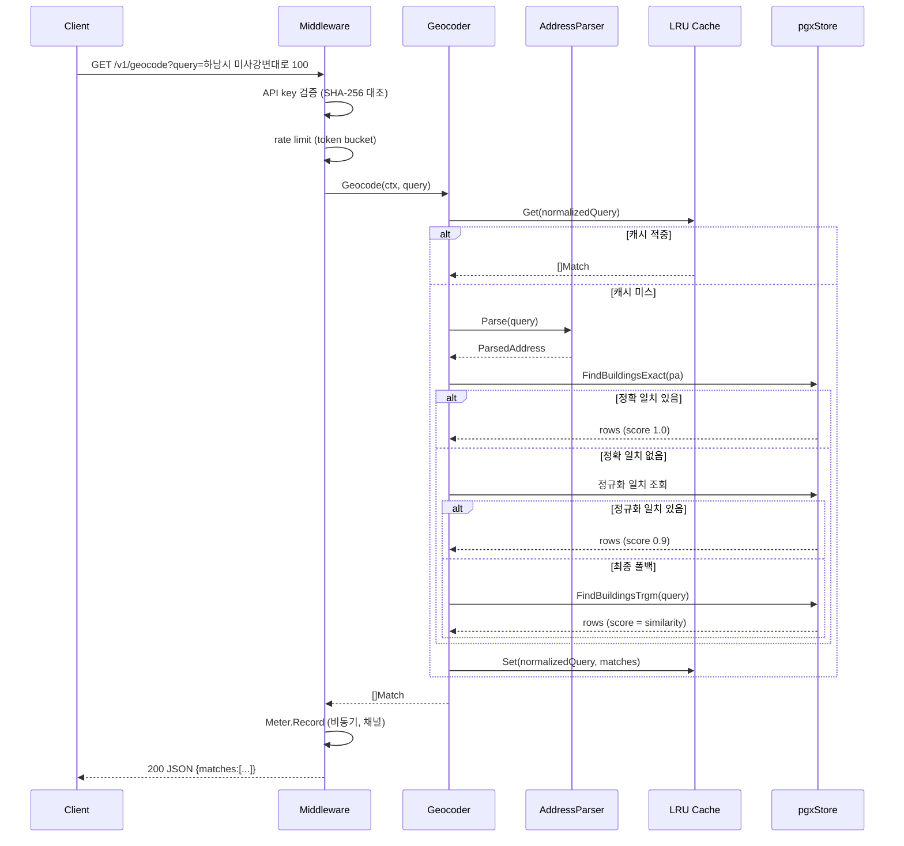
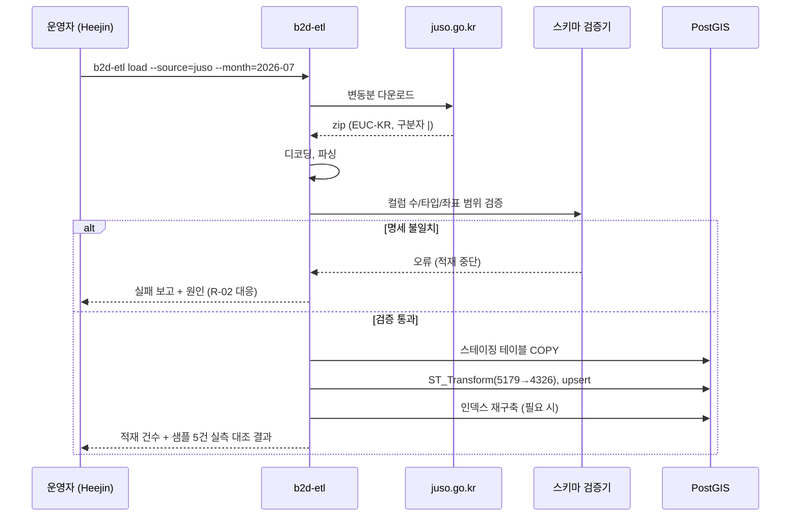
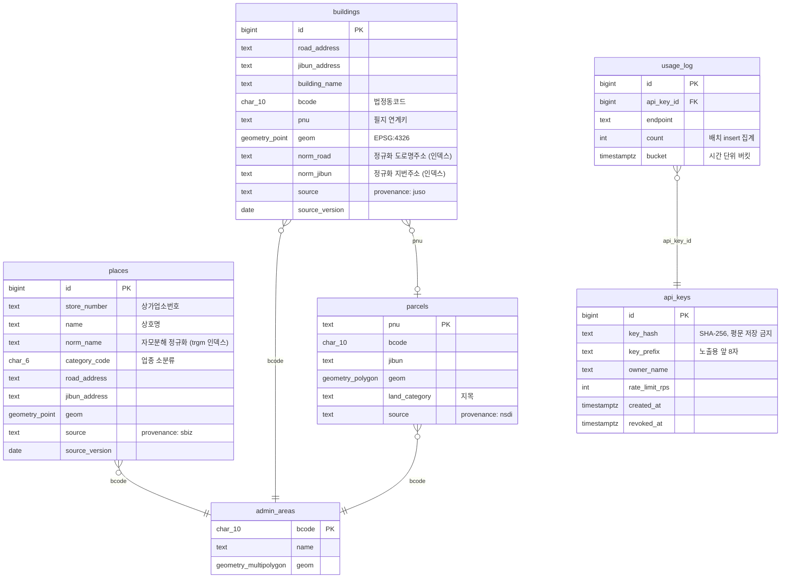
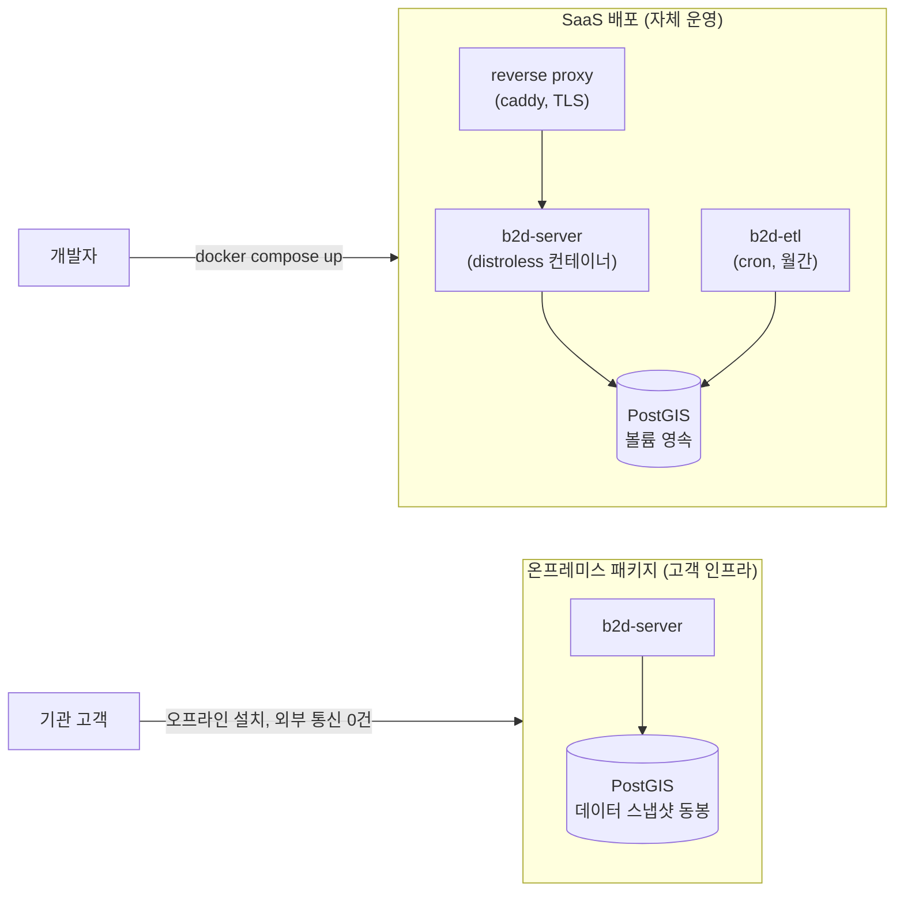

# UML 설계 문서
# b2d_geo — 공공데이터 기반 위치 서비스 엔진

- 문서 버전: 1.0
- 작성일: 2026-07-03
- 기반 문서: 01_SDP_b2d_geo.md
- 표기: Mermaid (GitHub/Obsidian에서 렌더링 가능)

---

## 1. 컴포넌트 다이어그램 (시스템 전체 구조)

핵심 판단: internal/address는 geocode와 places 두 핸들러가 공유하는 유일한
도메인 모듈이며 b2d_geo의 실질 자산이다. ETL과 서버는 DB를 통해서만 결합한다
(직접 호출 없음). 온프레미스 배포 시 External을 제외한 전체가 고객 인프라로 이동한다.

---

## 2. 클래스 다이어그램 (핵심 패키지)

Go는 클래스가 없으므로 struct/interface 기준으로 표기한다.

설계 원칙: Store를 interface로 두는 이유는 단위 테스트에서 pgx 없이 파서와
매칭 로직을 검증하기 위해서다. 프로덕션 구현체는 pgxStore 하나만 존재한다.
불필요한 추상화 계층 추가 금지 (단순성 원칙).

---

## 3. 시퀀스 다이어그램

### 3.1 Geocoding 요청 (3단 폴백)

### 3.2 ETL 월간 갱신

---

## 4. ERD (핵심 테이블)

인덱스 계획: buildings.geom / places.geom / parcels.geom / admin_areas.geom에 GiST,
buildings.norm_road / norm_jibun / places.norm_name에 gin_trgm_ops,
usage_log(api_key_id, bucket)에 복합 B-tree.

---

## 5. 배포 다이어그램

온프레미스 패키지는 ETL 결과 DB 스냅샷을 동봉하여 고객망에서 외부 통신 없이
동작한다. 이것이 BRD의 차별화 축 2번(온프레미스)의 기술적 근거다.
