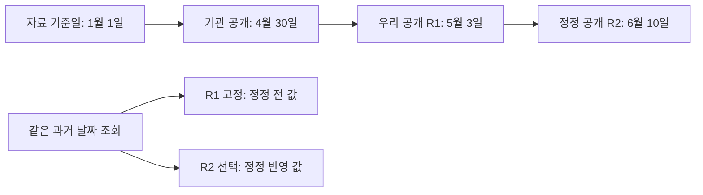
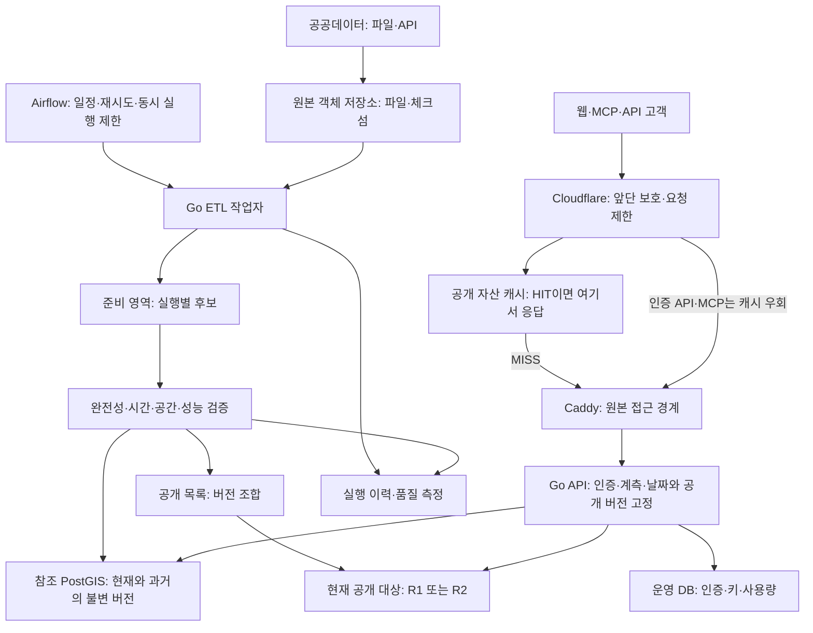
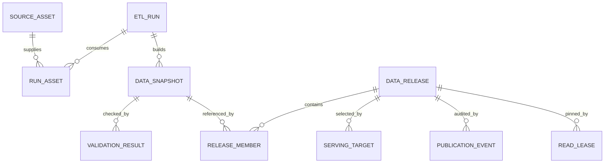
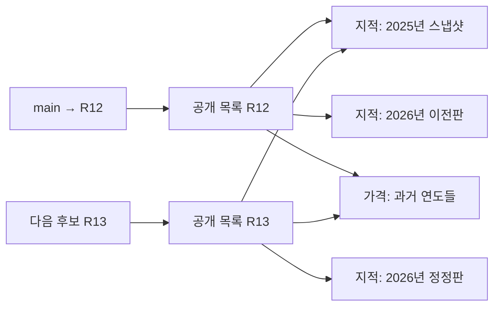
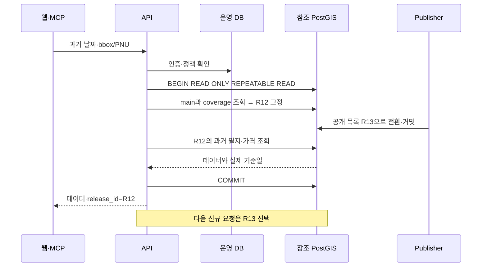
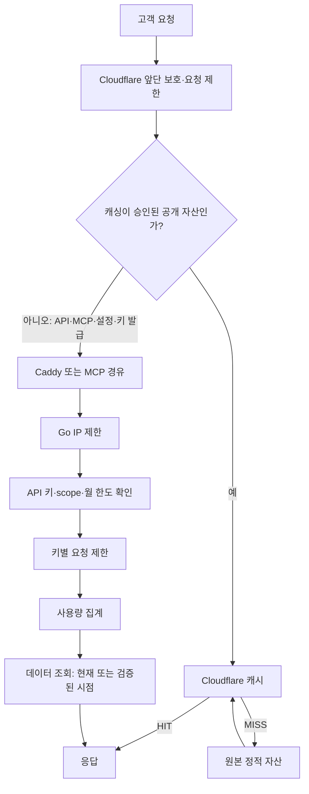
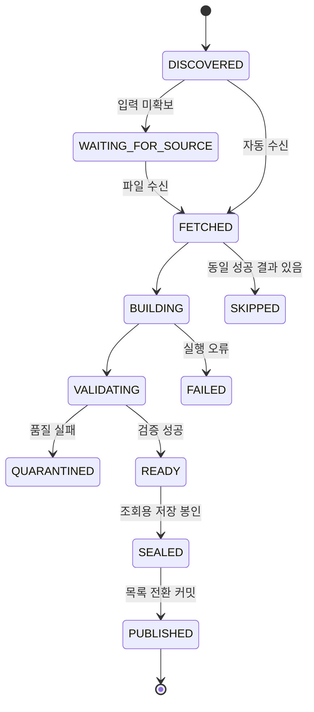
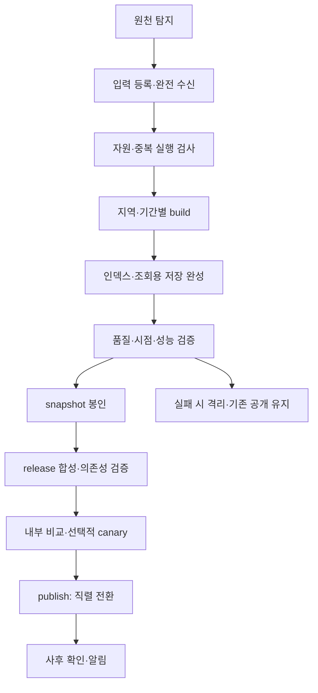

# b2d_geo ETL·시점 조회·데이터 공개 상세 설계

작성일: 2026-09-12 · 버전: 0.2 · 상태: 검토용 설계, ETL·시점 조회·Cloudflare 설정은 미구현

기준 코드: `eb2141fbb3c6c280c3df7c97585dc8da6d2b8f47` 및 작성 시점의 작업 디렉터리.

현재 동작은 소스로 확인하고 제안 구조·수치·API는 별도로 표시한다. 이 문서는 배포 전 설계 스냅샷이며 ETL·시점 조회·DB 스키마·Cloudflare 설정의 적용 완료 보고가 아니다. 별도 승인된 앱 배포에는 신뢰 프록시 IP 처리와 브랜드 이미지 교체만 포함한다. 잠시 추가했던 서버 응답 캐시는 사용자의 결정으로 원복했다. 기존 인증 결과 캐시·IP/키 요청 제한은 유지한다. 구체적인 상태·설정·검증 순서는 [런타임 운영 안내](/Users/mac/dev/b2d_geo/deploy/RUNTIME_CACHE_RATE_LIMIT.md)를 참고한다.

GitNexus CLI의 최신 작업 디렉터리 인덱스로 수정 대상 영향 분석을 수행했다. HTTP 인터페이스 호출에는 정적 분석의 누락 가능성이 있어 실제 소스도 대조했다. 이 결과를 아직 구현하지 않은 ETL·시점 조회 전체의 안전성 검증으로 해석하지 않는다.

## 읽는 순서

1. 제품이 약속할 내용과 시간의 의미: §1–3.
2. 실행 주기와 전체 구성: §4–6.
3. 데이터·DB·API 상세: §7–10.
4. 공개·롤백·검증·운영: §11–16.
5. 구현 순서·테스트·결정 사항: §17–20.
6. 용어와 근거: §21–22.

## 1. 설계의 출발점

### 1.1 사용자가 확정한 요구

**과거 특정 날짜의 지도·필지·가격을 즉시 조회할 수 있어야 한다.**

따라서 과거 파일을 압축 보관했다가 요청 시 복원하는 방식은 이 요구를 충족하지 않는다. 서비스가 지원한다고 표시한 지역·기간의 과거 자료는 사전에 검증·적재·인덱싱되어 있어야 한다.

기본 결정은 다음과 같다.

| 항목 | 선택 |
|---|---|
| ETL 실행 | HTTP 요청과 분리된 비동기 배치 |
| 공개 응답 캐시 | Cloudflare에서 우선 처리. 자체 Go 응답 캐시·Redis는 지금 추가하지 않음 |
| 인증·과금 API 캐시 | 우선 BYPASS. HIT에도 인증·권한·한도·사용량이 적용되는 설계가 완성된 뒤 검토 |
| 오케스트레이션 | 단계적으로 Airflow 적용, 기존 Go 처리 로직 재사용 |
| 데이터 공개 | 불변 데이터 버전을 완성한 후 공개 목록을 원자적으로 전환 |
| 기본 전환 | 데이터 A/B 방식. Canary는 검증 보조 수단으로 제한 도입 |
| 과거 조회 | PostGIS에 온라인으로 보존된 시점별 데이터 조회 |
| 런타임 연결 | 인증·사용량용 DB와 참조·이력용 PostGIS를 논리적으로 분리; 확장 시 물리 분리 |
| 데이터 정정 | 기존에 공개한 버전을 덮어쓰지 않고 새 버전 추가 |
| 범위 밖 요청 | 과거 자료 미보유를 명시. 현재 자료로 조용히 대체하지 않음 |
| 저장 용량 | 현재 VPS 사양을 충분하다고 가정하지 않음. 실측 후 역사 조회 범위 확장 |

### 1.2 ‘즉시’와 ‘과거 지도’의 범위

- 즉시는 **요청 시 ETL·압축 해제·백업 복원을 기다리지 않는 조회**를 뜻한다. 응답시간 목표는 §4의 검증 대상이다.
- 지도는 확보한 공공데이터에 따른 과거 필지 경계·주소·관련 속성 레이어를 뜻한다.
- 과거 항공사진·위성영상·상업 지도 배경까지 복원하는 요구는 현재 원천에 없으므로 포함하지 않는다. 현재 배경지도를 함께 쓰면 화면에 ‘배경지도는 현재, 필지 레이어는 선택 시점’이라고 구분한다.
- 과거 모든 날짜·전국 전체를 이미 지원한다는 뜻은 아니다. 원본 확보·완전성·색인이 확인된 범위만 coverage 목록에 공개한다.
- 초기 역사 조회 범위는 **시범 지역 1곳, 서로 다른 기준시점 2개 이상, 가격 정정 사례 1개 이상**으로 검증한다. 구체적 지역·날짜는 보유 원본 조사 후 확정한다.

### 1.3 현재 단계에서 추가하지 않는 것

- 데이터 원본에 없는 과거 상태 추정, 경계 보간, 가격 추정.
- 거래 지번이 가려진 자료를 특정 필지 거래라고 추정 연결하는 기능.
- Kafka·CDC·실시간 스트리밍과 동기식 DB 복제. 원천·제품 요구가 아직 이를 요구하지 않는다.
- 사용자 실험 지표를 비교하는 A/B 테스트 플랫폼.
- 전 데이터의 무제한 영구 보존 약속. 서비스가 지원하는 범위와 저장 비용을 함께 관리한다.

## 2. 현재 구현과 차이

아래는 작성 시점에 읽은 코드의 동작이다. 운영 서버에 접속하거나 ETL을 실행한 검증은 아니다. 서버 사양·DB 크기는 운영 문서의 기록이며 현재 실측값으로 간주하지 않는다.

| 구분 | 현재 구현 | 설계상 보완 |
|---|---|---|
| 실행 진입점 | `cmd/b2d-etl/main.go`의 데이터셋별 명령 | 실행 ID·입력 명세·검증·공개 단계 분리 |
| 통합 명령 | `download`, `load`, `index`는 미구현 분기 | 이 이름을 동작하는 통합 파이프라인으로 가정하지 않음 |
| 주소 한글 | `source='juso'` 전체 삭제·재삽입을 한 트랜잭션에서 수행 | 단일 지역 파일로 전국 기존 자료를 교체하지 않도록 범위를 명시하고 후보 버전에 적재 |
| 주소 관련지번 | 관련지번 파일 레이아웃 검증만 하고 병합하지 않음 | 다대다 관계가 필요한 조회는 별도 관계 모델로 추가; 이미 병합됐다고 가정하지 않음 |
| 상가정보 | `source='sbiz'` 삭제·재적재, 초성 보정은 별도 명령 | 초성·검색 인덱스까지 후보 완성 조건에 포함 |
| 출입구 | 메모리 내부 중복 제거 뒤 DB INSERT | 반복 실행·수정·삭제·안정적 식별키 검증 필요 |
| 지적도 | PNU 기준 upsert, 배치별 반영 | 폐지 필지 처리·과거 형상 보존·전체 후보 일관성 필요 |
| 토지이용계획 | 서비스 테이블 TRUNCATE 후 적재, PK도 작업 중 제거 | 준비 영역에서 완성 후 공개; 운영 테이블 선삭제 금지 |
| 공시지가·토지특성 | `(pnu, base_year)` upsert | 연도 안의 기준일·정정 이력을 추가 구분 |
| 실거래 ETL | 지역×월 삭제·재삽입, 한 번의 API 요청 | 전체 페이지·취소/정정·빈 결과 검증, 원자료 항목 보존 필요 |
| 실거래 위치 | 필지 집합에서 계산한 법정동 대표점, `EMD_CENTROID` | 과거 필지 정밀 거래 위치라고 표시하지 않음 |
| 실거래 API | 요청마다 국토부 직접 호출 | 배치로 확보한 온라인 데이터 조회로 전환하되 기존 응답 계약 검증 |
| 지가변동률 | 포털 JSON 파일 적재, 현재 행정구역 이름 매핑 및 과거 `(구)` 행 제외 | 과거 행정구역·분류 버전 포함, 수집 자동화 별도 필요 |
| 기준일 | 일부 명령에 고정 문자열, 일부는 `now()::date` | 원천 기준일·수집일·공개일 분리 |
| API DB 접근 | 대부분 전역 pgx Pool로 현재 테이블 조회 | 요청에 고정한 공개 목록·시점·동일 트랜잭션을 전달 |
| 관측 | API에 Sentry·X-Request-Id 구현 | ETL 실행 상태·데이터 품질·최신성 관측 추가 |
| 외부 접근 | 웹과 MCP가 HTTP API 사용 | 시간 파라미터·데이터 버전·coverage를 양쪽에 전달 |
| 요청 제한 | IP 20 req/s·burst 40, 키별 DB 설정·burst 2배 | Cloudflare 앞단 방어 추가; 프로세스별 제한을 전역 과금 한도로 오인하지 않음 |
| 캐시 | 인증 결과 기본 30초, 정적 파일 Cache-Control; 서버 API 응답 캐시 없음 | 공개 응답은 Cloudflare, 인증·과금 API는 우선 BYPASS |
| 프록시 IP | 로컬 변경으로 명시한 신뢰 CIDR에서 온 X-Forwarded-For만 해석 | 실제 프록시 IP·Cloudflare 경로는 배포 전 검증 필요; 기본값은 신뢰 없음 |

코드 근거:

- [ETL 명령](/Users/mac/dev/b2d_geo/cmd/b2d-etl/main.go), [주소 적재](/Users/mac/dev/b2d_geo/internal/etl/juso/load.go), [출입구 적재](/Users/mac/dev/b2d_geo/internal/etl/entrance/load.go).
- [토지이용계획 적재](/Users/mac/dev/b2d_geo/internal/etl/landuse/load.go:69), [실거래 적재](/Users/mac/dev/b2d_geo/internal/etl/landsales/load.go), [실거래 API](/Users/mac/dev/b2d_geo/internal/api/server.go:417).
- [지가변동률 적재](/Users/mac/dev/b2d_geo/internal/etl/priceindex/load.go), [공시지가 스키마](/Users/mac/dev/b2d_geo/migrations/007_appraisal.sql).
- [배포 구성](/Users/mac/dev/b2d_geo/deploy/docker-compose.yml), [운영 사양](/Users/mac/dev/b2d_geo/deploy/OPS.md:14).

## 3. 시간의 의미: 날짜를 붙이는 것만으로 과거 조회가 되지 않는다

### 3.1 네 가지 시각

| 필드 | 의미 | 예시 — 설명용 가상 값 |
|---|---|---|
| `source_as_of` | 원본이 어떤 시점의 자료인지 | 2026-01-01 기준 공시지가 |
| `source_published_at` | 제공기관이 공개·정정한 시각 | 2026-04-30에 공개 |
| `collected_at` | 우리 시스템이 수집한 시각 | 2026-05-02에 다운로드 |
| `published_at` | 우리 서비스가 검증 후 공개한 시각 | 2026-05-03부터 API 반영 |

원본이 별도 효력 시작·종료일을 제공하면 `effective_from`, `effective_to`를 추가 보존한다. 기준일을 효력 발생일로 임의 간주하지 않는다. 기관 공개일이 불명확하면 NULL·미확인으로 남기며 수집일로 위장하지 않는다.

### 3.2 두 가지 조회 기준

**기본 역사 조회는 `time_basis=snapshot`이다.**

- `as_of=2026-05-15&time_basis=snapshot`: 선택한 공개 목록 안에서 원천 기준일이 5월 15일 이하인 가장 가까운 완전한 스냅샷을 선택한다.
- 결과에는 실제 사용한 기준일과 자료의 시간 해상도를 반환한다. 5월 1일 자료를 사용했다면 그 사실을 표시한다.
- 이는 ‘5월 15일의 실제 상태를 완벽히 증명한다’는 뜻이 아니다. 5월 1일 이후 변경 자료가 없으면 그 사이의 변화는 알 수 없다.

`time_basis=effective`는 제공기관의 효력 날짜 및 해당 범위의 변경 이력이 검증된 데이터셋에만 지원한다. 근거가 부족하면 `TEMPORAL_BASIS_UNSUPPORTED`를 반환한다. 월별 전체분 사이를 임의의 실제 유효기간으로 만들지 않는다.

### 3.3 당시 서비스 응답과 정정된 과거 값

`as_of`는 대상 데이터 시점을, `release_id`는 **어떤 공개 목록을 기준으로 볼지**를 뜻한다.

- 같은 `as_of`라도 현재 release에서는 나중에 확인된 정정 자료가 반영될 수 있다.
- 과거에 생성한 결과를 재현하려면 당시 `release_id`, `as_of`, `time_basis`, 정규화된 입력과 API 코드 버전을 함께 기록한다.
- ‘그때 우리가 실제로 알던 값’은 특정 release로 재현한다. `known_at`을 받아 임의 시각의 release를 찾아주는 편의 기능은 후속 기능으로 둔다. 감사 수준의 시각 재현에서는 DB 기록 시각과 실제 커밋 가시 시각의 차이도 별도 정의해야 한다.
- 몇 년 전 데이터를 오늘 소급 수집한 경우, 과거 기준시점 조회는 가능하지만 ‘그 몇 년 전에 우리가 서비스했다’고 주장할 수 없다.



### 3.4 날짜·가격·행정구역을 섞지 않는 규칙

1. 날짜는 `Asia/Seoul`의 달력 날짜, 시각은 UTC `timestamptz`로 저장하고 표시 시 변환한다.
2. 기간은 `[시작, 종료)`로 표현한다. 종료 경계와 다음 시작 경계가 중복되지 않게 한다. PostgreSQL `daterange`가 이 표현을 지원한다.[S5]
3. 미래 기준일의 자료를 과거 요청에 사용하지 않는다.
4. 공시지가는 연도만으로 선택하지 않고 원천 기준일·가격 종류·정정 버전을 고려한다. 연중 여러 기준일이 있으면 연도 하나로 합치지 않는다.
5. 과거 PNU가 분할·합병으로 사라졌을 수 있다. 현재 PNU로 과거 필지를 추정하지 않는다. 선택 시점의 좌표 검색을 제공하고, 공식 연결 관계가 있을 때만 PNU 전후 관계를 노출한다.
6. 과거 지가변동률의 행정구역 개편·분류 체계는 당시 코드 버전으로 보존한다. 시계열 단절을 숨긴 누적 계산은 하지 않는다.
7. 지도·공시지가·이용계획의 원천 날짜는 서로 다를 수 있다. 한 요청의 release를 고정하되, 각 레이어의 실제 기준일을 별도로 반환한다.

### 3.5 보유 범위: coverage

`coverage`는 데이터셋·지역별로 어떤 기간·시간 기준을 조회할 수 있는지 기록한 목록이다.

- 최소 필드: 데이터셋, 지역 범위, 지원 시작·종료일, 누락 기간, 원천 기준시점 목록, 지원 time_basis, 온라인 여부, 완전성, 공개된 release.
- 최신 스냅샷 이후의 날짜에는 최신 관측 자료를 사용할 수 있지만 `freshness`와 실제 기준일을 표시한다. 이를 그 날짜의 상태가 검증됐다는 의미로 쓰지 않는다.
- 스냅샷 기준일이 오래됐다는 이유만으로 연간 자료를 오류 처리하지 않는다. 예상 갱신 주기와 새 자료 공개 여부를 함께 평가한다.
- 서비스가 지원한다고 표시한 과거 범위는 온라인 조회 상태를 유지한다. 단순 보존 정책으로 해당 범위를 콜드 아카이브로 옮기지 않는다.

## 4. 품질·최신성·성능 목표

이 절의 수치는 **초기 검증용 제안값**이다. 현재 서버에서 달성했다는 뜻도 고객 SLA도 아니다. 부하 시험과 원천 접근 조건을 확인한 뒤 확정한다.

| 항목 | 초기 목표·측정 조건 |
|---|---|
| 단일 필지·가격 시점 조회 | 지원 범위 내 p95 1초 이하, 캐시 미적중·조회 동시성 5에서 측정 |
| 지도 화면 조회 | 제한된 화면 범위·줌·피처 수에서 p95 2초 이하; 전국 원본 폴리곤 일괄 응답은 제외 |
| 데이터 공개 전환 | 데이터 복사·인덱스 작업을 제외한 목록 전환 트랜잭션 p95 1초 이하 |
| 롤백 | 이상 판단 후 자동 전환 작업 시작부터 5분 이내, DB 자체 장애는 별도 |
| 변동분·소량 API 갱신 | 입력 확보 후 24시간 내 공개 목표 |
| 대형 전체분 갱신 | 입력 확보 후 72시간 내 공개 목표, 파일 확보 지연은 별도 표시 |
| ETL 중 API 영향 | 동일 조건 기준 p95 지연 20% 이상 악화가 10분 지속하면 신규 무거운 작업 중단 |
| 공개 완전성 | 필수 원본·지역·기간 누락 0; 설명되지 않은 주요 키 충돌 0 |

최신성 지표는 세 가지를 구분한다.

- `source_lag`: 기대하는 원천 갱신이 제공기관에서 지연된 정도.
- `ingest_lag`: 원본 확보 후 준비·검증이 지연된 정도.
- `publication_lag`: 준비 완료 후 공개가 지연된 정도.

ETL이 실패해도 이전 자료가 여전히 유효하게 조회될 수 있다. HTTP 헬스체크 성공과 데이터 최신성을 같은 상태로 표시하지 않는다.

## 5. 데이터셋별 주기·병합·이력 정책

### 5.1 확인과 적재를 분리한 운영 일정

다음은 운영 제안이다. 기관의 확정된 공개 주기와 우리의 확인 주기를 혼동하지 않는다. 주소 일변동·상가 분기·지가변동률 월별 공개는 공식 안내를 참고했고, 지적·이용계획·각 공시지가 파일의 세부 공개 주기는 수집 계약별로 재확인해야 한다.[S1][S2][S3]

| 데이터 | 새 자료 확인 | 실제 적재·공개 | 역사 보존 단위 | 현재와의 차이 |
|---|---|---|---|---|
| 주소 한글 | 매일 06:00 KST 목록 확인 | 초기에는 확보한 월 전체분; 승인된 변경분 처리 구현 후 일 배치 | 지역×원천 기준시점 | 현재는 전체분 파서, 일변동 적용 별도 구현 필요 |
| 출입구 | 매일 목록 확인, 공급 방식 확인 | 원천 전체분·변동분에 맞춤, 주소와 호환성 검증 후 공개 | 지역×기준시점 | 반복 INSERT 교정 필요 |
| 상가정보 | 매주 월요일 06:15 | 새 분기 파일 확보 시 | 분기×지역 | 새 데이터와 초성 검색값을 함께 완성 |
| 지적도 | 매주 화요일 06:00 | 변경된 원천 범위만, 무거운 작업 큐에서 실행 | 시도×기준시점 | 과거 경계·폐지 필지 보존 필요 |
| 토지이용계획 | 매주 수요일 06:00 | 신규 원천 버전 확보 시 | 지역×기준시점 | 준비 영역으로 전환 필수 |
| 표준지·개별공시지가 | 매주 목요일 06:00; 공표 기간은 매일 확인 | 정기 공표와 정정분 모두 반영 | 지역×기준일×정정판 | 연도 PK 확장 필요 |
| 토지특성 | 매주 목요일 06:30 | 새 기준시점·정정분 확보 시 | 지역×기준시점 | 당시 속성 이력 필요 |
| 실거래 | 대상 지역 매일 05:00 | 최근 3개월 완전 재수집; 월 1회 최근 12개월 대조 | 시군구×계약월×수집판 | 페이지·취소·정정 처리 보완 |
| 지가변동률 | 25일~월말 매일 06:45 확인, 미공표 시 다음 달에도 재확인 | 새 월과 수정된 과거 월 적재 | 지역분류×월×정정판 | JSON 수동 확보 경로 유지 가능 |
| 과거 backfill | 운영자가 명시한 지역·기간 | 신규 갱신보다 낮은 우선순위 | 데이터셋별 원천 범위 | 과거 파일 접근성·쿼터 검증 필요 |

최근 3개월·12개월은 비용을 제한하기 위한 제안 범위다. 그 이전 정정이 없다는 보장은 아니다. 분기별로 서비스가 지원하는 오래된 기간을 나누어 대조하고, 원천 정정 공지가 있으면 해당 기간을 우선 재수집한다. 전체 대조 기간은 호출량 예산과 데이터 제공 범위로 설정한다.

### 5.2 공통 입력 계약

각 실행에는 다음 입력을 고정한다.

```text
dataset + coverage_scope + source_asset_ids + source_as_of
+ loader_image_digest + parser_contract_version
+ prerequisite_snapshot_ids + base_release_id
```

- 파일 기준일·식별자 확인은 가벼운 탐지 단계, 체크섬 검증은 파일 수신 완료 단계다.
- 같은 원본이라도 로더·좌표 변환·입력 사전이 달라지면 별도 처리 버전이다.
- 다운로드가 필요한 자료와 수동 업로드를 기다리는 자료 모두 같은 입력 계약을 사용한다.
- 원본 수신 시 ZIP 서명·CRC·크기·구성 파일·전체 지역 목록을 검사한다. HTML 오류 응답을 ZIP으로 저장한 상황을 성공으로 보지 않는다.
- 현재 주소 다운로드 코드에는 로그인 필요 시 수동 확보 경로가 있다. Airflow 도입으로 이 제한이 사라지는 것은 아니다. 해당 작업은 `WAITING_FOR_SOURCE`로 표시하고 무한 재시도하지 않는다.

### 5.3 ‘병합’의 세 종류

| 종류 | 처리 |
|---|---|
| 원천 변경 반영 | 후보 스냅샷 안에서 추가·수정·삭제 적용; 공개 중인 데이터는 그대로 |
| 이종 데이터 연결 | 주소·출입구·필지·행정구역을 공식 키로 연결, 연결 실패를 기록 |
| 공개 목록 합성 | 바뀐 데이터 버전만 새 목록에 넣고 나머지는 기존 불변 버전을 참조 |

전국 전체분을 받은 작업과 특정 지역 파일을 받은 작업을 같은 삭제 범위로 취급하지 않는다. 삭제·폐지 판정은 완전한 원천의 해당 범위에서만 수행한다. 전체분의 행 부재는 ‘해당 스냅샷에 없음’을 의미하며 정확한 폐지 날짜를 자동 생성하지 않는다.

실거래는 임의 합성키로 다른 거래를 한 건으로 줄이지 않는다. 안정적인 공식 거래 ID가 확인되기 전에는 완전 수집한 지역×월을 하나의 스냅샷으로 저장한다. 원본 중 동일해 보이는 여러 거래의 개수도 보존한다.

## 6. 목표 아키텍처

### 6.1 전체 구성



여기서 ‘공개’는 외부에 새 데이터가 선택되도록 만드는 단계다. 다운로드나 DB INSERT가 끝났다는 사실만으로 공개됐다고 처리하지 않는다. 이 단계의 ‘공개 release’는 인증 없이 누구에게나 제공한다는 뜻과 다르다. 유료 공개 release도 인증 API를 거친다. Cloudflare 경로는 목표 구성이며 현재 계정 설정을 확인하거나 적용한 상태는 아니다. MCP 요청은 Caddy에서 MCP 프로세스를 거쳐 내부 Go API에 도달한다.

### 6.2 물리 배치와 단계

| 단계 | 배치 | 의미 |
|---|---|---|
| 시범 검증 | 현 PostGIS 내 `build`, `ref`, `catalog` 스키마 + 별도 역할 | 적은 지역·기간으로 논리 격리와 조회 계약 검증 |
| 역사 조회 운영 | 인증·사용량은 기존 운영 DB, 참조·이력은 저장 공간을 확보한 별도 PostGIS | ETL·공간 조회 부하를 계정·과금 데이터와 분리 |
| 실행 제어 | Airflow와 그 metadata DB는 참조 DB와 별개인 관리 환경 | 오케스트레이터 장애가 현재 API 조회를 막지 않게 함 |
| 무거운 처리 | ETL 작업자를 API 프로세스와 분리 | 변환 CPU와 작업 메모리 경쟁 완화; 최종 DB I/O 경쟁은 별도 제한 |

현재 160GB 서버에 전국의 여러 해 공간 이력과 Airflow를 모두 추가하는 배치를 기본안으로 삼지 않는다. 별도 PostGIS의 서버 종류·디스크 크기·관리형 여부는 §15의 실측으로 정한다. 이 문서는 새 서버 생성이나 비용 발생을 승인한 배포 지시가 아니다.

런타임은 최종적으로 `OPERATIONS_DATABASE_URL`과 `REFERENCE_DATABASE_URL`의 두 연결 풀을 갖는 구성을 제안한다. 이름은 신규 제안이며 현재 설정은 `B2D_DATABASE_URL` 하나다. 초기 이행 중 두 주소가 같은 인스턴스를 가리킬 수 있어도 계정 권한과 풀은 분리한다.

### 6.3 역할·권한

| 역할 | 허용 범위 |
|---|---|
| API 운영 역할 | API 키 확인·발급과 필요한 사용량 기록; 참조 데이터 수정 불가 |
| API 참조 역할 | 공개 가능한 sealed 스냅샷·공개 목록 읽기; build·원본 비밀값 접근 불가 |
| ETL 작업 역할 | 실행별 build 영역, 원본 읽기, 후보 등록; 공개 포인터 수정 불가 |
| Publisher 역할 | 검증된 후보 봉인·목록 등록·공개 전환; 고객 키·사용량 변경 불가 |
| Retention 역할 | 참조 해제·보존 기간·lease를 확인한 대상만 정리 |

Sentry DSN은 관측 설정, MOLIT 키는 수집 인증, 고객 API 키는 서비스 인증이다. 원본 URL에 포함된 인증키를 메타데이터·로그·예외에 저장하지 않는다. 서버가 같은 DB에 있어도 읽기 전용 스키마만으로 자원 격리는 되지 않는다.

## 7. 데이터 모델: 원본, 스냅샷, 공개 목록을 구분한다

### 7.1 핵심 개념

- **원본 자산(source asset):** 기관에서 받은 파일·API 응답과 그 체크섬.
- **스냅샷(snapshot):** 특정 데이터셋·지역·기준시점의 완전하고 검증된 조회 자료.
- **공개 목록(release manifest):** API가 사용할 수 있는 현재·과거 스냅샷과 해석 규칙의 불변 목록.
- **공개 대상(serving target):** 현재 기본 요청이 선택할 release를 가리키는 작은 레코드.

새 release는 주소 한 지역만 바뀌어도 만들 수 있다. 변하지 않은 필지·가격·과거 스냅샷은 기존 것을 공유하므로 release를 만들 때 DB 전체를 복제하지 않는다.



그림의 표 이름은 설계상 명칭이며 현재 DB에 존재한다는 뜻이 아니다.

### 7.2 메타데이터 테이블 계약

다음 테이블은 제안이다. 타입·외래키·인덱스·제약은 migration 구현 전에 검증한다.

| 테이블 | 주요 항목·제약 |
|---|---|
| `catalog.source_assets` | `asset_id`, dataset, scope, URI, SHA-256, bytes, source_as_of, source_published_at, collected_at, format, 완전성. 비밀값을 제거한 URI만 기록 |
| `catalog.etl_runs` | `run_id`, attempt, build_key, base_release_id, image_digest, contract_version, state, timestamps, error_class. 시도마다 별도 ID |
| `catalog.run_assets` | 실행과 입력 원본의 연결, 순서, 예상 파일 수 |
| `catalog.data_snapshots` | snapshot_id, dataset, coverage_key, source_as_of, revision, schema_version, storage_kind, storage_locator, counts, bytes, lineage, sealed_at |
| `catalog.snapshot_inputs` | 생성에 사용한 주소·행정구역·지적 등의 snapshot_id. 입력 의존관계 유지 |
| `catalog.validation_results` | snapshot/run, rule_version, rule, expected, observed, status, evidence_uri, checked_at |
| `catalog.data_releases` | release_id, parent_release_id, contract_version, manifest_hash, created_at, sealed_at. 봉인 후 내용 불변 |
| `catalog.release_members` | release_id, dataset, coverage_key, target_period, revision, snapshot_id, selection_policy |
| `catalog.serving_targets` | channel=`main/canary`, release_id, generation. 롤백도 generation 증가 |
| `catalog.publication_events` | old_release, new_release, generation, operation_id, reason, actor, recorded_at. 추가 기록만 허용 |
| `catalog.read_leases` | release_id, lease_kind, expires_at, opaque_token_id. 페이지·보고서 처리의 참조 보호 |
| `catalog.retention_pins` | snapshot/release/assets, reason, until. 온라인 제공·계약·복구 검증을 위해 참조 유지 |

메타데이터는 JSON 하나에 전부 넣지 않는다. release·dataset·지역·기준시점·상태는 관계형 컬럼과 제약으로 관리한다. 원천별 추가 설명만 JSON을 사용한다.

### 7.3 불변성·중복 방지 제약

1. 봉인된 스냅샷의 내용·스키마·기준일은 수정하지 않는다. 정정은 새 snapshot_id로 만든다.
2. release에는 봉인되고 필수 검증을 통과한 스냅샷만 들어간다.
3. 같은 release·데이터셋·범위·동일 기준시점에서 서로 모순되는 활성 정정판이 선택되지 않게 한다.
4. 시간 선택 규칙은 release 계약 버전에 포함한다. 나중에 규칙이 바뀌어도 옛 release의 의미를 바꾸지 않는다.
5. `build_key`는 원본 목록·체크섬·로더 버전·입력 사전 버전·범위로 계산한다. 같은 키의 성공 결과가 있으면 재사용한다.
6. 같은 원본이더라도 정정 원본이나 로더 변경이면 새 키다. ‘이미 해당 월 실행함’만으로 건너뛰지 않는다.
7. Airflow 재시도는 at-least-once다. DB 멱등성으로 중복 공개를 막으며 exactly-once 실행이라고 부르지 않는다.

## 8. 물리 저장: 과거를 계속 읽을 수 있는 A/B

### 8.1 스냅샷과 역사 조회용 데이터



A/B는 두 고정 테이블을 반복해서 덮어쓰라는 뜻이 아니다. 실제 저장 이름은 재사용하지 않는 버전 식별자를 사용한다. 이전 release를 롤백할 수 있는 기간과 과거 날짜 조회를 지원할 기간은 별개다.

### 8.2 첫 구현에서 선택할 저장 방식

정확성을 검증하기 쉬운 **완전 스냅샷 + 변하지 않은 범위 재사용**을 첫 구현으로 한다. 온라인 과거 조회가 이 스냅샷을 직접 읽으므로 일별 변경 로그를 매 요청마다 재생하지 않는다.

| 데이터군 | 조회용 물리 저장 제안 | 조회 경로 |
|---|---|---|
| 지적·주소/출입구·상가 | 데이터셋×지역×기준시점별 불변 관계; 해당 관계에 공간·검색 인덱스 | release가 선택한 관계에서 필지/주소/공간 검색 |
| 토지이용계획 | 지역×기준시점별 관계, `(pnu, zone_code)` 등 검증된 키 인덱스 | 시점에 맞는 관계에서 PNU 검색 |
| 표준지·개별지가·토지특성 | 지역×기준일별 스냅샷 집합. 큰 연도 범위는 파티션 사용 | 기준일·지역으로 범위를 좁힌 후 PNU 검색 |
| 실거래 | 계약연도 등으로 분할한 고정 테이블에 `snapshot_id`별 불변 지역×월 자료 | 선택한 snapshot_id + 지역·계약기간 |
| 지가변동률 | 소량 이력은 snapshot_id별 보존, 시군구 코드체계와 월 키 포함 | 선택한 판의 지역·월 조회 |
| 행정구역·코드표 | 기준시점별 불변 자료 | 공간·가격 자료와 호환되는 코드판 선택 |

큰 공간 데이터의 모든 행에 여러 거대한 release 문자열을 붙이지 않는다. release와 snapshot의 연결은 메타데이터에서 관리한다. 행 기반 이력에 필요한 snapshot_id는 짧은 내부 키를 쓴다.

데이터가 매번 바뀌면 완전 스냅샷은 공간을 계속 사용한다. 이것은 명시적인 비용이다. `61GB×12=732GB`는 전체 자료를 매월 같은 크기로 완전 복제한다고 가정한 단순 예시일 뿐 실제 견적이 아니다. 변동이 없는 범위 공유·원천별 주기 차이·압축·역사 조회 범위에 따라 달라지고 WAL·추가 인덱스는 별도다.

### 8.3 범위 재사용과 파티션 주의점

- 검증된 정규화 결과가 이전과 완전히 같으면 같은 물리 객체를 재사용할 수 있다. 새 원본 관측 시각과 입력 자산 연결은 별도 메타데이터로 남긴다.
- 지역을 나누는 기준은 해당 원천 코드판으로 고정한다. 행정구역 개편 시 현재 코드만으로 과거 경계를 자르지 않는다.
- 한 조회가 여러 지역에 걸치면 필요한 관계만 선택해 합친다. 지역 경계 후보 집합은 선택 시점의 coverage geometry로 계산한다.
- 스냅샷 수만큼 무제한 파티션을 만들지 않는다. 일별×지역별 수만 파티션은 계획 비용을 측정한 후 선택한다.[S6]
- PostgreSQL 파티션 하나를 여러 부모에 동시에 attach해 버전 공유할 수 있다고 가정하지 않는다. 불변 관계 공유는 registry 참조와 조회 조합으로 처리한다.
- 관계 이름은 서버가 생성·등록한 allowlist에서만 선택하고 pgx 식별자 quoting을 적용한다. 사용자 입력으로 테이블 이름·search_path를 만들지 않는다.

### 8.4 변경 이력 압축은 별도 검증 후 적용

보존 비용이 커지면 변경된 행만 새 revision으로 보관하는 방식(SCD Type 2 등)을 검토한다. 선택된 시간 구간에서 유일한 상태가 정해져야 하며, 정정 전 결과도 재현할 수 있어야 한다.

단, 원천 전체분 사이의 실제 변경 날짜는 알 수 없다. 저장 구간이 있어도 그것을 실제 효력 기간으로 표시하지 않는다. 관측 구간과 효력 구간을 구분한다. 압축형 저장을 채택하더라도 조회 시 긴 변경분 체인을 재생하지 않고 인덱싱된 상태·구간을 조회한다.

이 최적화는 첫 이행의 필수 조건이 아니다. 시작부터 전국 다년 이력을 제공하려면 완전 스냅샷 비용과 압축형 설계의 개발 비용 중 하나를 실제로 감당해야 하며, 현재 디스크에 모두 들어간다고 약속하지 않는다.

### 8.5 봉인과 내구성

- 파싱 중간 자료에는 재생성 가능한 UNLOGGED 테이블을 사용할 수 있다.
- 공개 가능한 ref 자료는 장애·복원 정책을 만족하는 logged 저장으로 완성한다. UNLOGGED 후보가 프로세스 재시작 후 남아 있다고 가정하지 않는다.
- logged 전환·데이터 이동·인덱스 생성·ANALYZE는 공개 포인터 전환보다 먼저 끝낸다. 이 단계의 WAL·디스크·잠금 비용도 예산에 포함한다.
- 준비 테이블에 인덱스를 만들어도 실제 runtime 쿼리 계획을 검사한다. 후보 테이블 PK만 있다고 공간 검색이 빠르다는 뜻은 아니다.
- 공개 중인 테이블 rename만으로 의존 view·함수·캐시가 모두 새 대상을 볼 것이라고 가정하지 않는다. registry를 통해 명시적으로 버전을 선택한다.

## 9. 런타임·API 계약

아래 엔드포인트·필드는 **신규 제안**이다. 현재 구현된 기능과 혼동하지 않는다.

### 9.1 요청이 읽는 DB와 순서

1. 운영 DB에서 API 키·scope·사용량 정책을 확인한다.
2. 참조 DB에서 읽기 전용 `REPEATABLE READ` 트랜잭션을 시작한다.
3. 처음에 main/canary 또는 유효한 조회 토큰이 지정한 release를 한 번 선택한다.
4. `as_of`, time_basis, bbox/PNU에 맞는 스냅샷과 coverage를 확정한다.
5. 필지·가격·행정구역 등 모든 참조 조회를 같은 트랜잭션·release 컨텍스트로 실행한다.
6. 응답 데이터와 metadata를 준비한 뒤 트랜잭션을 끝낸다. 네트워크 전송 동안 장기 DB 트랜잭션을 유지하지 않는다.
7. 사용량 기록은 운영 DB 경로에서 별도로 수행한다.

일반 READ COMMITTED에서는 같은 트랜잭션 안의 두 SELECT도 서로 다른 커밋 상태를 볼 수 있다. 읽기 스냅샷과 불변 release를 함께 사용한다. 이것만으로 잘못 조합된 원천 시점이 자동 정합해지는 것은 아니므로 공개 검증도 필요하다.[S4]



현재 `geocode`, `parcel`, API 함수들이 전역 Pool을 직접 쓰는 경로는 Queryer/Tx를 받을 수 있게 변경해야 한다. 트랜잭션을 열고도 내부 함수가 다른 Pool 연결로 조회하면 이 계약을 충족하지 못한다.

### 9.2 날짜 선택·coverage·조회 컨텍스트

| 제안 API | 역할 |
|---|---|
| `GET /v1/data/coverage` | 데이터셋·지역별 지원 기간·기준시점·시간 기준·온라인 상태 |
| `GET /v1/data/context?as_of=...&time_basis=snapshot` | 여러 지도 타일·API 호출에 공통으로 쓸 서명된 조회 컨텍스트 발급 |
| 기존 필지·공시지가·특성 API의 시간 파라미터 | `as_of`, `time_basis`, 조회 컨텍스트를 선택적으로 지원 |
| `GET /v1/map/parcels` | bbox·줌·시점에 맞는 과거 필지 레이어. 첫 버전은 제한된 GeoJSON 응답 |
| 후속 MVT 타일 API | 피처 수가 많을 때 지도 타일로 제공. 원본 조회·판정용 형상과 화면용 단순화를 구분 |

날짜 없는 기존 요청은 현재 공개된 최신 스냅샷을 사용한다. `base_year`와 `as_of`를 동시에 받아 모호해지는 초기 계약에서는 둘의 동시 사용을 400으로 거부한다. 이후 별도의 가격 기준일 파라미터로 명확히 확장할 수 있다.

지도를 처음 열 때 컨텍스트를 받아 관련 타일·가격 조회에 재사용한다. 토큰에는 release, as_of, time_basis, 권한 범위 식별, 만료시각을 넣고 서명한다. 원문 API 키는 포함하지 않는다. 다른 고객의 토큰을 재사용할 수 없게 검증한다. 초기 토큰 유효기간은 24시간 제안이며 보존 lease와 연결한다.

release_id를 알고 있다는 이유만으로 비공개 후보나 권한 없는 과거 자료에 접근시키지 않는다. 공개 이력이 있거나 허용된 canary release인지 검증한다. 페이지 커서는 release와 정렬키를 포함하고 서명한다. 만료 뒤 최신 데이터로 조용히 이어붙이지 않고 재시작을 안내한다.

### 9.3 응답 예시

다음 값은 형식 설명용 가상 값이다.

```json
{
  "data": { "pnu": "example-pnu", "geometry": "..." },
  "meta": {
    "release_id": "rel_example_13",
    "requested_as_of": "2026-05-15",
    "time_basis": "snapshot",
    "layers": {
      "parcels": {
        "snapshot_id": "snap_example_21",
        "source_as_of": "2026-05-01",
        "temporal_resolution": "source_snapshot",
        "completeness": "complete",
        "freshness": "within_policy"
      },
      "official_price": {
        "snapshot_id": "snap_example_44",
        "source_as_of": "2026-01-01",
        "revision": "provider-correction-2"
      }
    },
    "warnings": ["선택 날짜 이전의 최신 원천 스냅샷입니다."]
  }
}
```

`X-Request-Id`는 요청 식별자, 제안하는 `X-Data-Release`는 데이터 목록 식별자다. Sentry에는 두 값을 연결하되 주소·개인정보·인증키를 기본 전송하지 않는다. 복합 응답은 단일 날짜 헤더 하나로 모든 원천 시점을 대표하지 않는다.

### 9.4 오류와 부분 결과

| 상황 | 제안 응답 |
|---|---|
| 날짜 형식·미래 날짜·상충 파라미터 | 400 `INVALID_TEMPORAL_QUERY` |
| 보유하지 않은 과거 기간 | 422 `TEMPORAL_COVERAGE_UNAVAILABLE` + 지원 범위 |
| 효력 기준을 증명할 수 없음 | 422 `TEMPORAL_BASIS_UNSUPPORTED` |
| 해당 지역 미적재 | 422 `REGION_NOT_LOADED` |
| 조회 토큰 만료·회수 | 410 `DATA_CONTEXT_EXPIRED` 또는 `DATA_RELEASE_REVOKED` |
| 완전한 해당 시점 자료에서 PNU 없음 | 404 `PARCEL_NOT_FOUND_AT_DATE` |
| 예상과 달리 공개 자료의 저장 객체가 유실됨 | 503 `DATASET_UNAVAILABLE` + 운영 알림 |

복합 지도 조회는 기본적으로 요청한 필수 레이어 중 하나라도 coverage가 없으면 실패시킨다. `allow_partial=true`를 명시한 경우에만 누락 레이어·지역을 metadata에 표시하고 나머지를 반환한다. 미수집과 실제 거래 0건을 구분한다.

### 9.5 공간 조회·캐시

- 좌표/PNU 조회도 선택 시점의 지적·주소 데이터로 처리한다. 가격만 과거로 바꾸고 경계를 현재로 남기지 않는다.
- 공간 필터는 후보 bbox를 줄인 뒤 정확한 교차 판정을 수행한다. PostGIS의 ST_Intersects 등은 공간 인덱스 활용이 가능하지만 실제 쿼리 계획은 측정해야 한다.[S7]
- bbox 최대 면적·줌별 피처 상한·응답 바이트 상한을 계약으로 둔다. 수치는 시범 데이터로 결정한다.
- 향후 시점 데이터 캐시 키는 서버가 검증한 release, as_of, time_basis, 지역/bbox 또는 타일, 모든 결과 필터, 응답 스키마 버전, 필요한 권한 범위를 포함한다. 단순 Cache Rule의 기본 키로 이 요구가 충족된다고 가정하지 않는다.
- 역사 조회용 컨텍스트는 신규 공개 시에도 고정된다. 날짜 슬라이더를 바꾸면 새 컨텍스트를 요청한다.
- 정밀 좌표 검색에는 원본 geometry를 사용한다. 화면용 단순화 타일을 공적 경계의 원본으로 반환하지 않는다.
- MCP의 도구 스키마·인자 전달·응답 metadata도 동시에 갱신한다. 웹만 시점 파라미터를 지원하면 사용자별 결과가 달라질 수 있다.

### 9.6 캐시 책임: Cloudflare 우선, Go 응답 캐시 제외

2026-09-12 결정: 새 Go 응답 캐시와 해당 테스트·환경변수는 원복한다. 캐싱 여부·대상을 먼저 확정하고, Cloudflare를 앞단 캐시로 사용한다. Redis와 다단 응답 캐시를 지금 추가하지 않는다. 이는 백엔드 캐시가 일반적으로 잘못된 기술이라는 뜻이 아니라, 현재 제품의 중복 조회량·적중률·과금 경계가 아직 검증되지 않았다는 판단이다.

인증 조회 결과를 30초 보관하는 기존 `auth` 캐시는 API 응답 캐시와 다르다. 이를 없애면 키 검증 DB 부하가 늘 수 있으므로 유지한다. 키 폐기 반영 지연과 높은 보안 요구에서는 `B2D_AUTH_CACHE_TTL=0s`를 따로 선택한다.



그림은 책임 순서다. 실제 Cloudflare 룰의 실행 순서·카운팅 옵션·요금제에서 캐시 HIT도 제한되는지는 배포 전 테스트한다. 원본에서만 세는 제한으로 엣지 HIT까지 보호했다고 주장하지 않는다.

| 대상 | 1차 정책 | 후속 경로 |
|---|---|---|
| JS·CSS·로고·파비콘·vendor 파일 | Cloudflare 캐싱 후보. 해시 없는 파일은 짧은 TTL 또는 명시적 무효화 | 해시 경로 자산은 긴 TTL·immutable 검토 |
| 일반 HTML | 초기에는 기본 동작 유지, 별도 장기 캐싱 안 함 | 배포 시 갱신·메뉴/정책 문구 변경 정책을 확정한 후 적용 |
| `/config.json`, `/issue-demo-key` | 캐시 BYPASS | 브라우저에도 no-store 응답 정책 필요 |
| `/v1/*` | 무료 데모도 포함하여 캐시 BYPASS | 공개 익명 API를 별도 계약·경로로 만들거나 인증된 Worker 설계 후 재검토 |
| `/mcp`, `/mcp/*` | 캐시 BYPASS; POST·세션·스트리밍을 정적 응답으로 취급하지 않음 | 도구가 읽는 데이터의 캐시는 API 계약에서 검토 |
| 향후 공개 버전 타일·공개 통계 | 재배포·무과금 제공이 승인된 경로만 캐시 후보 | release가 포함된 불변 URL과 엄격한 입력 검증 |

현재 모든 데이터 API는 키 검증 체인을 거친다. `type=a` 결과가 모든 고객에게 같아도 서비스 접근 권한과 과금은 별개다. API 키를 캐시 키에 넣는 것만으로 키 폐기·scope 변경·잔여 한도 검증이 해결되지 않는다. `X-API-Key`라는 사용자 정의 헤더가 있다는 이유로 Cloudflare가 자동으로 안전하게 분리한다고 가정하지 않는다. Cloudflare는 JSON/HTML을 기본적으로 모두 캐싱하는 것도 아니다.[S12][S13]

### 9.7 인증 API를 나중에 엣지 캐싱한다면

아래는 **후속 설계 조건**이며 이번에 Worker를 만들거나 배포하지 않는다.

1. Worker에서 요청을 검증하고 인증·scope·기간별 제품 권한·키 폐기 정책을 적용한다. 캐시 HIT도 동일하다.
2. 키별 요청 제한과 월 한도 승인을 캐시 확인 전에 수행한다. 지역별 속도 제한과 전역 월 과금 한도는 다른 기능이다.
3. 과금은 요청 식별자로 멱등하게 기록하거나 한도를 선예약·정산하는 계약을 둔다. 이벤트 유실·중복·집계 장애 시 처리를 명시한다. 실패하면 과금을 건너뛰고 HIT만 반환하지 않는다.
4. 서버 또는 검증 가능한 서명 컨텍스트에서 release·시점·접근 범위를 확정한다. 브라우저가 보낸 임의 release/권한 헤더를 신뢰하지 않는다.
5. 이 후에 캐시를 조회한다. MISS만 Go의 데이터 조회 경로로 보낸다. 기존 meter와 Worker가 같은 요청을 이중 청구하지 않게 과금 책임자를 하나로 정한다.
6. 서비스 토큰·원본 접근 제한으로 Worker를 건너뛴 내부 조회 API 호출을 차단한다. 장애 시 우회 경로도 동일한 인증·과금 보장을 가져야 한다.

초기에 이 복잡도를 감수할 근거가 없다면 인증 API는 계속 BYPASS가 적절하다. Cloudflare의 Worker rate limiting binding은 위치별 제한으로 설명되므로 이를 정확한 전역 월 한도 저장소로 대신 쓰지 않는다.[S14]

### 9.8 요청 제한과 캐싱이 해결하는 범위

- 캐싱은 동일한 결과를 재사용해 조회·CPU·원본 송신을 줄인다. 캐시 HIT를 만드는 네트워크와 엣지 처리에도 비용이 있다.
- 요청 제한은 허용량을 넘는 호출을 억제한다. 캐시 HIT에도 필요하며 IP 하나만으로는 공유 NAT와 여러 IP 공격을 구분하기 어렵다.
- 기존 Go 제한은 프로세스별 토큰 버킷이다. 서버 복제본이 늘면 전체 허용량도 달라진다. 전역 보장이 필요해지면 공유 카운터 또는 검증된 엣지 정책을 설계한다.
- 기존 사용량 meter는 비동기 버퍼·실패 시 기록 누락 가능성이 있다. 월 캡은 즉시·정확한 결제 원장이 아니다. 캐시 도입과 별개로 유료 사용량 보증이 필요하면 내구성·예약·재시도·중복 방지 작업을 선행한다.
- Go IP 제한만으로 대규모 네트워크 DDoS를 방어했다고 주장하지 않는다. Cloudflare 앞단 방어·원본 접근 제한과 DB timeout·최대 응답 크기·동시성 제한을 함께 검증한다.
- Caddy를 신뢰 프록시로 지정해도 Cloudflare→Caddy 구간의 신뢰 설정이 자동으로 생기지 않는다. 직접 접근 차단과 전달 헤더 검증은 [운영 안내](/Users/mac/dev/b2d_geo/deploy/RUNTIME_CACHE_RATE_LIMIT.md)에 따로 적었다.[S15]

### 9.9 공개 버전과 캐시 갱신

공개 데이터라면 `/public/releases/{release}/tiles/{z}/{x}/{y}` 같은 버전 포함 경로를 제안한다. 새 데이터는 새 URL이므로 이전 캐시를 덮어쓸 필요가 없다. 이 경로는 아직 존재하지 않는다. 최신 release를 알려주는 작은 포인터는 캐싱하지 않거나 최신성 계약에 맞는 짧은 TTL로 둔다. 전체 DB 갱신마다 CDN 전체 purge를 하는 구조를 기본으로 잡지 않는다.

지원 중인 과거 버전은 온라인 DB에서 다시 만들 수 있어야 한다. CDN은 언제든 MISS가 날 수 있고 DB·과거 보존·백업을 대체하지 않는다. 날짜만 같아도 정정 release가 다르면 캐시를 공유하지 않는다. canary와 main도 검증된 release를 키에 포함한다.

잘못 공개한 데이터·권한 회수는 예외다. 이전 release로 롤백해도 이미 캐시된 잘못된 URL이 자동 삭제되지는 않는다. 해당 release의 새 접근 거부와 표적 purge·대체 안내를 함께 수행한다. 브라우저가 이미 장기 저장한 공개 자료를 완전히 회수할 수는 없으므로 민감하거나 회수 가능성이 높은 데이터에는 긴 브라우저 TTL을 적용하지 않는다.

### 9.10 비용과 도입 판단

원본 API 호출량만 비교하지 말고 엣지 요청 수·HIT/MISS·응답 바이트·AWS 원본 송신·WAF/Rate Limiting 옵션·Worker 실행·로그 비용을 같이 본다. Cloudflare 캐시가 무료·무제한이거나 항상 AWS 비용을 낮춘다고 가정하지 않는다. 요금제와 실제 트래픽은 미확인이므로 금액을 확정하지 않는다.

1차는 Worker 없이 승인된 정적 자산용 Cache Rules와 보호 규칙을 검토한다. 2차는 공개 버전 타일·통계가 제품 요구에 실제로 있을 때 추가한다. 3차 인증 API 캐시는 동일 조회 반복량과 SQL 부하가 측정되고 §9.7 계약을 만족할 때만 진행한다. 자유 입력 주소·좌표는 가능한 키가 많아 `type={a,b,c,d}`와 같은 적중률을 기대할 수 없다.

## 10. 데이터셋별 설계 세부사항

### 10.1 주소·출입구·행정구역

주소와 출입구는 동일한 개체 모델이 아니다. 현재 한글 주소 적재는 geom이 없는 행을 만들고 출입구는 별도 출처 행을 넣는다. 문자열 정규화 키가 같다는 이유만으로 이를 영구 식별키라고 보지 않는다.

- 원천의 안정적 관리번호·공식 연결표를 우선 검증한다.
- 하나의 주소에 출입구가 여러 개일 때 대표점 선택 규칙을 버전으로 보존한다.
- 매칭 실패는 미연결 상태와 원인을 남긴다. 임의 좌표를 생성하지 않는다.
- 행정구역 명칭·코드 사전도 역사 데이터다. 초기 이행은 현재 사전으로 처리한 범위의 한계를 명시하고, 과거 지도 공개 전 당시 사전을 확보한다.
- 일변동 적용은 신규·변경·폐지 코드와 순서를 검사한다. 중간 일자 누락 시 다음 날 변경만 적용하지 않고 원천 복구 또는 전체분 기준 재구축한다.

### 10.2 지적·토지이용계획

- 시도별 ZIP 내 분할 SHP가 모두 있는지 확인한다.
- 좌표계와 데이터 해석 규칙은 원천 계약으로 고정하고, 재투영·도형 보정 건수를 보고한다.
- 서로 다른 snapshot의 필지 경계를 한 bbox 결과 안에서 무표시 혼합하지 않는다. 지역별 시점이 다르면 명시한다.
- 토지이용계획은 현재 로더가 PNU별 속성 자료를 적재한다. 이를 자체 용도지역 폴리곤 원천이 이미 구현된 것처럼 취급하지 않는다. 지도 색상은 선택 시점 필지에 해당 속성을 연결하는 범위에서 제공한다.
- 분할·합병 이력은 공식 관계가 없으면 자동 추정하지 않는다.

### 10.3 공시지가·토지특성

- 논리키는 데이터셋·PNU·공식 기준일·원천 판으로 구분한다. `base_year`는 검색 편의 필드다.
- 동일 기준일 정정은 새 snapshot을 만들고 이전 release에서 이전 값이 유지된다.
- 표준지와 개별공시지가는 가격 종류가 다르다. 현재 API의 표준지 우선 정책을 역사 시점 선택과 함께 재검토하고 명시한다. 다른 연도의 표준지가 있다는 이유로 요청 시점의 개별지가를 가려서는 안 된다.
- 선택 시점에 없는 필지의 가격을 현재 PNU로 억지로 연결하지 않는다.

### 10.4 실거래

- 수집 페이지의 전체 건수·각 페이지 건수·중복 페이지·응답 코드·중간 변경 가능성을 검사한다.
- 원천이 수집 중 일관된 스냅샷을 보장하지 않으면 재대조 후 완전성을 판정한다. 한 번 `numOfRows`를 크게 지정한 것만으로 완전 수집을 증명하지 않는다.
- 현재 parser가 보존하지 않는 취소·정정 식별 필드를 공식 스키마와 대조한다. 수집 성공만으로 계약 이행 완료라고 판단하지 않는다.
- 원천 지역×계약월 스냅샷을 보존하고 삭제·추가·수정 비교 결과를 감사 메타데이터로 남긴다.
- 계약일과 수집판의 공개일은 다르다. ‘해당 날짜까지 체결된 거래’와 ‘당시 서비스에서 조회됐던 거래’는 release 선택으로 구분한다.
- 법정동 대표점은 집계 위치다. 이를 과거 특정 필지의 거래로 표시하지 않는다. 위치 보강에 사용한 지적·법정동 사전 snapshot도 lineage에 포함한다.
- 기존 upstream JSON과 DB 컬럼 사이의 표현 차이를 계약 테스트로 확인한 후 런타임을 DB 조회로 전환한다. 데이터 미보유 시 원천을 동기 호출해 메우는 숨은 fallback은 기본안에 없다.

### 10.5 지가변동률

월별 값의 정정판과 당시 행정구역·용도지역 분류를 보존한다. 현재 이름 매핑에서 제외하는 `(구)` 행도 역사 조회 대상 여부를 개별 판정한다. 행정구역 개편 전후를 연결한 추세는 연결 규칙이 없으면 시계열 단절로 반환한다. 포털 JSON 파일 수신과 자동 API 수집은 별개 구현 항목이다.

## 11. 실행·검증·공개 상태

### 11.1 실행 상태



상태는 실행·스냅샷·release별로 별도 관리한다. 위 그림은 이해를 위한 대표 실행 흐름이다. 한 스냅샷은 여러 release에서 사용될 수 있으므로 rollback했다고 스냅샷 자체를 FAILED로 바꾸지 않는다.

- `FAILED`: 네트워크·파서·DB 오류. 재시도 가능 여부를 분류한다.
- `QUARANTINED`: 작업은 끝났지만 데이터 공개 기준을 통과하지 못함.
- `WAITING_FOR_SOURCE`: 자료 미공개·수동 확보 필요. 무한 실패 알림을 내지 않음.
- `READY/SEALED`: 데이터가 준비됐다는 뜻이며 아직 사용자가 읽는다는 뜻은 아님.

### 11.2 공개 전 필수 검증

| 검사군 | 필수 조건·증거 |
|---|---|
| 입력 완전성 | 파일·지역·페이지 목록, CRC/체크섬, 예상 범위와 실제 범위 일치 |
| 행 집계 | 입력=정상 반영+사유별 제외+검증된 중복 처리; 설명되지 않은 차이 없음 |
| 키 | PNU·관리번호 형식, 동일 키의 모순된 값 0 |
| 공간 | 원천 좌표계, 변환 후 범위·유효성, 검증 앵커 비교 |
| 시간 | 미래 자료 섞임 0, 기준일·수집일 분리, 정정판 우선순위 명확 |
| 이력 | 앞 snapshot 누락·폐지와 범위 완전성의 관계 검증 |
| 연결 | 주소↔좌표, 필지↔가격, 과거 행정구역 매핑률과 실패 사유 |
| 검색 | 주소 정규화·초성·인덱스·ANALYZE 완료 |
| 회귀 | 알려진 질의와 A/B 차이, 변경 원천에 따른 설명 |
| 성능 | 현재·과거·캐시 미적중·동시 ETL 조건의 계획·지연·읽은 블록 |

전체 행수가 일정 비율 감소하면 경고·보류하는 임계값은 데이터셋별로 정한다. 초기 제안은 이전 동일 범위 대비 5% 초과 감소 시 검토 대상으로 두되, 이를 정상적인 폐업·정리 자료도 무조건 틀렸다고 보는 규칙으로 사용하지 않는다. 품질 임계값은 버전 관리한다.

### 11.3 공개 트랜잭션

새 데이터의 이동·인덱싱은 이미 끝났고, release 후보가 봉인된 뒤 실행한다.

```text
BEGIN
  현재 main target 행을 잠금
  expected_generation 및 expected_release 확인
  후보의 필수 검증, storage 존재, coverage, 스키마 호환 확인
  이전 공개 목록 이후 데이터셋 변경·의존성 변경 충돌 검사
  publication operation_id 중복 여부 확인
  publication_event 기록
  main.release_id = candidate_release_id
  main.generation = old_generation + 1
COMMIT
```

전환 작업만 짧은 트랜잭션에 둔다. 수십 GB INSERT를 이 안에서 실행하지 않는다. `lock_timeout`을 짧게 두고 잠금 획득이 지연되면 기존 서비스 버전을 유지한 채 재시도한다. 오래 기다리다가 무조건 전환하지 않는다.

동시 작업이 각각 다른 데이터셋을 갱신해도 예전 목록 전체를 덮어쓰면 상대 작업의 갱신이 사라질 수 있다. generation 충돌 시 최신 release를 부모로 후보 목록을 다시 합성하고, 해당 변경이 독립적인지 재검증한다. 늦게 끝난 옛 원본 작업이 최신 자료를 자동으로 되돌리지 않게 한다.

### 11.4 커밋 직후 응답 유실

Publisher가 커밋 뒤 응답을 받기 전에 죽을 수 있다. 재실행은 `operation_id`와 publication event 및 target을 먼저 확인한다. 이미 공개된 경우 성공을 재확인하고, 데이터를 다시 적재하거나 같은 알림·공개 이벤트를 중복 생성하지 않는다. 알림 실패가 공개 성공을 취소하지 않는다.

## 12. A/B·Canary·롤백

### 12.1 기본 전환

현재 release A와 후보 B를 같은 코드·테스트 입력으로 비교한다. 검증 후 신규 요청의 target을 B로 바꾸고 기존 요청은 고정한 A로 마무리한다. 작은 데이터셋부터 이 과정을 검증한다.

Blue-Green은 본래 두 애플리케이션 환경을 사용하는 방식이고 Canary는 일부 트래픽부터 새 환경을 검증하는 방식이다. 이 설계는 원리를 데이터 버전 선택에 적용한다. 코드 배포와 데이터 공개를 한 번에 변경하지 않는 것을 기본으로 한다.[S8]

### 12.2 선택적 Canary

- 초기에는 내부 검증 계정만 B를 선택한다. 고객 canary는 데이터 버전 차이가 허용되는 계약에서만 사용한다.
- 계정·프로젝트 또는 서명된 조회 컨텍스트 기준으로 고정한다. HTTP 요청마다 무작위 A/B 배정하지 않는다.
- 신규 지도 컨텍스트에 한해 1%→10%→50%→전체 같은 증가를 적용할 수 있지만 비율과 관찰 기간은 실측으로 정한다.
- 기존 컨텍스트는 만료까지 같은 release를 유지한다. 명백한 오류 release는 회수하고 410으로 재시작을 요구할 수 있다.
- 트래픽이 적으면 충분한 표본을 얻지 못한다. 시간만 지나면 자동 승격하지 않고 필수 합성 질의·대표 지역·정정 사례의 검증 완료를 요구한다.
- Sentry 오류율 외에 누락·좌표·가격판·API 지연을 본다. 200 응답은 데이터 정확성의 증거가 아니다.

### 12.3 Shadow 비교

동일 질의를 후보에 복제해 내부 결과만 비교할 수 있다. 이 호출은 사용자 사용량·과금에 중복 집계하지 않는다. 샘플을 제한하고 DB 부하 예산 안에서만 실행한다. 주소 입력 등 요청 자료 보관은 최소화한다. 결과 차이가 있으면 원천 변화인지 회귀인지 분류한다.

### 12.4 롤백과 호환성

- 이전 검증된 release로 main을 다시 설정하되 generation은 증가시킨다.
- 참조 목록 전환으로 되돌릴 수 있는 것은 데이터 선택이다. 이미 고객에게 전달된 결과·생성된 보고서까지 취소되지는 않는다. 문제가 있는 release를 표시하고 영향 범위를 추적한다.
- 이전 버전을 읽을 수 없는 새 API 스키마를 배포하면 데이터 rollback만으로 복구되지 않는다. 적어도 현재·직전 계약 버전을 읽는 호환성 기간을 둔다.
- migration은 expand→검증→전환→보존기간 후 contract 순서로 계획한다. 활성·역사 조회에 쓰이는 컬럼·관계를 먼저 삭제하지 않는다.
- DB 자체 장애·데이터 디스크 유실은 release rollback으로 해결되지 않는다. 백업·복구 절차와 별도다.

## 13. Airflow 설계

### 13.1 역할과 배포

Airflow는 일정·의존성·재시도·backfill·동시 작업 제한을 담당한다. Go는 원천 해석·공간 변환·적재를 담당한다. 데이터 공개 가능 여부와 공개 사실의 최종 근거는 참조 DB의 catalog다. Airflow 실행 화면을 데이터 정합성의 단일 근거로 삼지 않는다.

첫 운영 구성은 작은 관리 환경에 LocalExecutor 등 단순 executor를 검토하며 Celery·Redis·Kubernetes를 전제로 하지 않는다. 실제 Airflow 버전·provider 호환 조합은 구현 시 고정하고 공식 구성으로 검증한다. 원천 대기에는 worker를 점유하지 않는 reschedule/지원되는 deferrable 방식 또는 짧은 탐지 실행을 사용한다.



### 13.2 Pool·동시 실행

초기 제안은 `fetch` 2개, 무거운 참조 DB 작업을 위한 **공유 `reference_io` Pool 1개**, `publish` 1개다. 대형 적재·인덱스·백필·대형 정리는 모두 같은 reference_io를 사용한다. 서로 다른 DAG용 Pool을 따로 만들면 대형 작업이 겹칠 수 있다.

Airflow 밖에서 실행되는 백업도 같은 운영 조정·잠금에 참여해야 한다. Pool은 수동 CLI 실행을 막지 못하므로 DB 실행 잠금과 자원 입장 검사를 함께 둔다. Session advisory lock을 쓰는 작업은 전용 연결을 유지하고 연결 상실 시 해당 작업의 소유권을 잃은 것으로 취급한다. 강제로 잠금을 무시한 병렬 실행은 기본 명령에서 허용하지 않는다.

Airflow Pool과 slot은 태스크의 동시 실행량을 제어할 수 있다.[S9] 현재 shared staging 이름 충돌 문제는 Pool만 믿고 남겨두지 않고 run별 build namespace로 제거한다.

### 13.3 재시도와 backfill

| 상황 | 정책 |
|---|---|
| 일시 네트워크 오류·429 | 지수 백오프·jitter, 원천 재시도 안내·일별 쿼터 준수 |
| 401·키 미설정 | 재시도 폭주 금지, 운영 설정 오류 알림 |
| 아직 미공표·수동 파일 대기 | WAITING_FOR_SOURCE, 다음 확인 일정 |
| 포맷 변경·좌표계 불명 | QUARANTINED, 무조건 자동 재시도하지 않음 |
| 중간 DB 오류 | 후보 상태 확인 후 재시도; 공개 대상에는 영향 없음 |
| publish 충돌 | 최신 부모 목록과 의존성 재검증 후 다시 합성 |

과거 backfill은 범위 목록을 먼저 미리보기하고 작업량·쿼터·용량을 확인한다. 모든 과거 날짜를 자동 catchup으로 생성하지 않는다. 현재 자료 갱신을 우선하고 작은 지역·기간부터 실행한다. Airflow는 과거 날짜 실행과 별도의 동시 실행 제한을 지원하지만, 실제 데이터 유효기간은 원천 metadata에서 가져온다.[S10]

배치 논리 날짜가 2025년이라고 해서 오늘 받은 파일의 원천 기준일을 2025년으로 바꾸지 않는다.

## 14. 관측·로그·알림

### 14.1 반드시 남길 식별자

| 문맥 | 식별자 |
|---|---|
| 사용자 조회 | request_id, release_id, opaque query context ID |
| ETL | run_id, attempt, build_key, asset_id, snapshot_id |
| 공개 | operation_id, parent/current release, generation |
| 처리 근거 | loader digest, parser 계약 버전, validation 규칙 버전 |

### 14.2 측정값

다운로드·파싱·적재·인덱스·검증·공개·정리 단계별 시간, 원본/행/DB 바이트, 제외 사유, 최대 RSS, CPU, 임시 파일, WAL, DB 잠금 대기, API p50/p95/p99, 현재·과거 쿼리의 캐시 적중 여부를 기록한다. 측정 전 실행시간 추정치를 실측으로 보고하지 않는다.

Sentry는 코드 예외와 요청 실패 추적에 사용한다. 품질 실패·미공표·coverage 누락·갱신 지연은 구조화된 실행 기록과 지표로 관리한다. 품질 이상이 예외를 발생시키지 않더라도 공개를 차단할 수 있어야 한다.

### 14.3 알림 분류

- 즉시 대응: 공개 객체 유실, 잘못된 가격판·경계 노출, 공개 실패로 현재 조회 불가, 디스크 안전 여유 소진.
- 업무시간 검토: 품질 검사 격리, 새 파일 포맷, 원천 키·권한 문제, 지원 기간 확장 불가.
- 정보성: 정상 미공표, 동일 원본 skip, 일시 재시도, 완료 요약.

자연스러운 원천 미공표와 실제 오류를 구분해 같은 경고가 계속 반복되지 않게 한다. 알림 전달 채널은 기존 운영 수단에 연결하고 이 설계 작업에서 외부 메시지를 보내지는 않는다.

## 15. 용량·실행시간·비용 설계

### 15.1 현재 자료에서 알 수 있는 것

운영 문서는 8GB RAM·2 vCPU·160GB SSD 및 약 61GB PostGIS를 기록한다. 대형 정렬·인덱스 작업의 I/O 지연도 기록돼 있다. 이는 모든 ETL의 실행시간·현재 여유공간 측정표는 아니다.

### 15.2 실행 입장 조건

```text
필요 추가 여유
  = 새 후보 최종 데이터·인덱스
  + 실행 중 staging·정렬 최대치
  + 예상 WAL·온라인 history insert 증가
  + 작업 중 백업·수신 파일 임시 여유
  + 운영 안전 여유
```

`현재 free disk > 필요 추가 여유`를 만족하지 못하면 작업을 시작하지 않는다. 이미 디스크에 존재하는 활성·역사 자료는 used 공간이며 free와 중복 합산하지 않는다. 안전 여유의 초기 제안은 전체 볼륨 20%와 최근 측정된 피크 불확실성을 함께 반영하되, 측정값이 없으면 전국 전체 재구축을 허용하지 않는다.

### 15.3 실행별 측정 양식

| 데이터/지역/기준시점 | 다운로드 | 변환 | DB 적재 | 인덱스 | 검증 | 최대 추가 디스크 | 최대 RSS | API 지연 영향 |
|---|---|---|---|---|---|---|---|---|
| 시범 데이터 | 미측정 | 미측정 | 미측정 | 미측정 | 미측정 | 미측정 | 미측정 | 미측정 |

작은 지역·중간 지역·가장 큰 지역에서 최소 3회 비교한다. 용량×시간 선형 비례를 전국의 확정 소요시간으로 사용하지 않는다. 정렬·인덱스·캐시 상태가 달라질 수 있다.

### 15.4 대형 역사 조회 확장 조건

1. 지원 지역·보존 기간·시간 해상도를 coverage 계약으로 제한한다.
2. 시범 스냅샷의 실제 heap·index·WAL·압축 원본 크기와 변경 비율을 측정한다.
3. 필요한 온라인 디스크·백업·작업 저장소·Airflow 관리 자원의 월 비용을 견적한다.
4. 현재 VPS에 부족하면 참조 PostGIS를 별도 인스턴스/볼륨으로 이전한다. 추가 공간 확보 없이 최신 테이블을 먼저 비우는 우회는 하지 않는다.
5. 데이터가 드물게 바뀌면 범위 공유가 효과적이고, 자주 바뀌면 §8.4의 변경 이력 저장을 검증한다.

로드밸런싱의 초기 초점은 여러 API 서버로 요청을 나누는 것보다 DB I/O·적재·백업·과거 조회의 동시 작업량을 제한하는 데 있다. 스키마·DB 이름이 달라도 같은 디스크라면 경합한다.

## 16. 보존·정리·복구

### 16.1 서로 다른 보존 목적

| 대상 | 초기 정책 제안 |
|---|---|
| 서비스가 지원하는 과거 snapshot | 온라인 유지. A/B 전환 이후에도 제거하지 않음 |
| 직전 release·결과 재현 metadata | 최소 30일 빠른 rollback/고정 컨텍스트 지원; 계약이 요구하면 연장 |
| 원본·로더·검증 근거 | 해당 온라인 역사 자료를 재생성할 수 있도록 함께 보존 |
| 실패 staging | 실행 종료·lease 없음 확인 후 7일; 용량 경보 시 진단 근거 보관 후 조기 정리 검토 |
| 성공 임시 파일 | 공개·복구 근거 확인 후 24시간 이후 정리 가능 |
| 실행 상세 로그 | 90일 제안, 요약·공개 이력은 제공 범위 및 감사 요구에 맞춰 유지 |

‘30일 뒤 이전 release 삭제’가 ‘30일 전 필지 데이터 삭제’를 의미하지 않는다. 새로운 release가 참조하는 역사 snapshot은 계속 유지한다. 새 정정판이 활성화된 뒤 정정 전 판의 보존도 기존 컨텍스트·재현 계약·원본 보관 정책을 따라 결정한다.

### 16.2 정리 조건

객체를 지우기 전에 다음 참조를 모두 검사한다.

1. main·canary·보존 대상 release의 직접 참조.
2. 다른 snapshot의 lineage 의존성.
3. 지원 중인 역사 조회 coverage.
4. 아직 유효한 지도·페이지·보고서 lease.
5. 장애 조사·보존 pin.

GC와 새 publish/lease 발급은 동일한 메타데이터 잠금 규칙으로 경합을 조정한다. MARKED_FOR_DELETION 상태의 객체를 새 release에 붙이거나 새 lease에 넣지 못하게 하고, mark 후 grace period와 재확인을 거쳐 삭제한다. DB 활성 조회와 relation drop 잠금도 확인한다. 단순 파일 나이만 보고 삭제하지 않는다.

### 16.3 백업·복구

- 운영 DB의 고객 키·사용량은 공공데이터 원본으로 복구할 수 없으므로 독립 백업 대상이다.
- 참조 DB 백업은 catalog와 payload의 일관된 시점을 포함해야 한다. 메타데이터만 복원해 존재하지 않는 snapshot을 공개하지 않는다.
- 원본 보관은 DB 백업을 완전히 대신하지 않는다. 전국 이력을 재생성하는 데 시간이 걸리기 때문이다.
- 복구 시 current target이 참조하는 객체·행수·인덱스·원본 lineage·과거 조회 샘플을 확인한 뒤 API에 연결한다.
- RPO/RTO는 백업 주기와 복원 실측 후 확정한다. 현재 설계만으로 무손실·즉시 복구를 보장하지 않는다.

## 17. 구현 순서와 완료 기준

한 번에 전국 자동화와 모든 과거 데이터를 켜지 않는다. 다음 순서로 작동 가능한 단위를 만든다.

| 단계 | 구현 내용 | 완료 기준 |
|---|---|---|
| P0 원본·현황 조사 | 과거 원본 inventory, 실DB 크기·쿼리·권한·원천 계약 확인 | 데이터셋별 지원 가능한 날짜·지역·미보유 사유와 비용 기준선 |
| E0 엣지 보호·정적 캐시 | P0와 병행 가능. Cloudflare 계정·도메인·룰·원본 경로 확인 | 정적 HIT, 인증 API/MCP BYPASS, HIT에도 속도 제한, 우회 차단·비용 확인 |
| P1 안전한 build | run별 namespace·범위·멱등성, 출입구 중복/land-use 선삭제 제거, 기준일 분리 | 재실행·중간 실패가 기존 서비스에 영향 없음 |
| P2 catalog·공개 | snapshot/release/target·CAS 공개·rollback·봉인·validation | price-index 등 작은 데이터로 이중 실행·커밋 응답 유실 테스트 통과 |
| P3 시간 조회 시범 | 시범 지역의 서로 다른 날짜 필지·가격·행정구역 자료 적재 | 날짜별 경계·가격이 다르게 조회되고 actual source date가 표시됨 |
| P4 런타임 연결 | Queryer/Tx·두 Pool·공통 조회 컨텍스트·coverage·웹/MCP 전달 | 여러 API·지도 요청이 같은 release/time을 유지 |
| P5 실거래 DB 전환 | 완전 수집·원문 스키마·취소/정정·지역×월 coverage | upstream 장애 중 지원 범위 조회 유지, 미보유와 0건 구분 |
| P6 Airflow 운영 | 탐지·run·Pool·retry·publish·backfill·알림 | 신규 갱신과 과거 수집이 자원 예산 내에서 실행 |
| P7 저장소 확장 | 참조 PostGIS 물리 분리 또는 디스크 확장·백업 복구 | 목표 역사 범위·지연·동시 ETL 부하 시험 통과 |
| P8 점진 공개 | 내부 검증·필요시 고객 canary·지원 범위 확대 | 품질·성능·rollback·보존/GC 검증 후 확대 |

P2의 작은 데이터 성공만으로 역사 지도 요구가 완료된 것은 아니다. 최소 P3·P4에서 실제 서로 다른 시점의 경계와 가격을 한 화면·컨텍스트로 검증해야 한다.

### 17.1 현재 테이블 이행

1. 실제 서비스 테이블과 원천 이력을 조사해 `legacy baseline`으로 등록한다. 원본·일자가 불확실하면 재현 가능 상태라고 표시하지 않는다.
2. 현재 API가 읽는 테이블을 비우거나 바로 rename하지 않는다. 새 조회 경로를 먼저 만들고 결과·성능을 대조한다.
3. migration은 작게 분리한다. 현재 migration runner는 파일 전체를 한 트랜잭션으로 실행하므로 `CREATE INDEX CONCURRENTLY` 같은 트랜잭션 밖 작업을 그대로 넣지 않는다. 별도 운영 작업 경로를 설계한다.
4. 참조 읽기 Pool·버전 선택을 기능 플래그로 내부 검증한다.
5. 실제 metadata가 확인된 baseline release로 현재 API 결과를 유지한 뒤 새 역사 데이터를 추가한다.
6. 인증·사용량 테이블과 MCP 라우팅이 이행 중 유지되는지 계약 테스트한다.

### 17.2 심볼 영향 분석이 필요한 예상 수정 영역

구현 직전에 GitNexus impact를 실행할 대상의 출발점이다. 호출자·위험 등급을 지금 확인했다는 뜻은 아니다.

- `cmd/b2d-etl/main.go`의 run 함수·기준일·연결 설정.
- `internal/etl/*/load.go`의 Load·batch flush·staging·충돌 처리.
- `internal/api/server.go`의 New·시간 조회 핸들러·실거래·공시지가 선택.
- `internal/geocode`, `internal/revgeo`, `internal/places`, `internal/parcel`의 DB 접근.
- `cmd/b2d-server/main.go`의 Pool 초기화·종료.
- `cmd/b2d-mcp/main.go`와 웹의 API 인자·응답 전달.

## 18. 검증 시나리오

| ID | 시나리오 | 기대 결과 |
|---|---|---|
| T01 | 같은 입력·로더로 2회 실행 | 결과 중복·중복 공개 없음 |
| T02 | build 중 강제 종료 | main과 기존 현재/과거 조회 유지 |
| T03 | 지역 전체분 중 SHP 한 조각 누락 | 공개 거부; 삭제 판정 금지 |
| T04 | 이전보다 행수 급감 | 규칙에 따라 격리·설명 요구 |
| T05 | 지적 후보 형상 일부 무효 | 정해진 보정·격리 규칙과 보고, 무음 누락 없음 |
| T06 | 동일 기준일 공시지가 정정 | 새 release는 정정값, 이전 release는 이전 값 |
| T07 | 동일 PNU의 전후 경계 변경 | as_of에 맞는 geometry 반환 |
| T08 | 분할 전/후 PNU | 실제 시점의 존재 여부 반영, 현재 PNU로 과거 추정 금지 |
| T09 | 과거 자료 없는 날짜 | 422와 정확한 coverage |
| T10 | snapshot만 가능한 자료에 effective 요청 | 명시적 미지원 |
| T11 | 지도 타일 중간에 release 교체 | 같은 컨텍스트의 모든 타일·가격은 같은 release |
| T12 | publish commit 뒤 응답 유실 | operation_id로 성공 재확인, 중복 공개 없음 |
| T13 | 다른 데이터셋의 동시 publish | generation 충돌 감지, 상대 변경 유실 없음 |
| T14 | 늦게 끝난 오래된 원본 작업 | 최신 자료를 자동 후퇴시키지 않음 |
| T15 | 실제 조회 중 rollback | 진행 요청 버전 유지; 새 컨텍스트는 이전 검증판 |
| T16 | canary 계정 연속 조회 | 무작위 버전 변경 없음, cache도 격리 |
| T17 | 실거래 API totalCount가 한 페이지보다 큼 | 모든 페이지 수집 전 공개 불가 |
| T18 | 실거래 수집 중 데이터 변경 | 원천 일관성 정책에 따라 재대조·격리 |
| T19 | 정상적인 실거래 0건 | 완전한 0건과 미적재를 구분 |
| T20 | 취소·정정 필드·동일해 보이는 복수 거래 | 원천 계약대로 보존, 임의 중복 제거 없음 |
| T21 | 과거 행정구역 개편 | 당시 코드 사용, 시계열 단절 표시 |
| T22 | 만료 페이지 컨텍스트 | 410, 최신 결과로 무음 연결 금지 |
| T23 | lease가 있는 과거 snapshot GC | 삭제되지 않음 |
| T24 | 새 publish와 GC 동시 실행 | 삭제 표식·잠금 규칙으로 존재하지 않는 버전 공개 방지 |
| T25 | DB 복원 뒤 과거 조회 | catalog·payload·인덱스 일관성 확인 |
| T26 | ETL과 현재/과거 조회 동시 부하 | 정의한 지연·메모리·디스크 예산 충족 |
| T27 | Sentry·로그 점검 | request/run/release는 연결되고 비밀값은 제외 |
| T28 | 웹·MCP 동일 시점 입력 | 동일 데이터 버전·coverage·오류 계약 |
| T29 | 신규 runtime 코드와 이전 release | 호환 기간 내 이전판 조회·rollback 가능 |
| T30 | 현재 배경지도 위 과거 필지 표시 | 배경과 레이어 시점을 구분하는 UI 표시 |

## 19. 결정 기록

| 결정 | 이유 | 비용·한계 |
|---|---|---|
| 요청과 ETL 분리 | 원천 지연·수집 실패가 HTTP 지연으로 전파되지 않게 함 | 최신성 지연을 명시해야 함 |
| PostGIS로 과거도 온라인 조회 | 사용자 확정 요구가 과거 날짜 즉시 조회 | 과거 geometry·인덱스 저장 비용 |
| 불변 snapshot과 release 목록 | 교체 중 일관성·rollback·재현 | registry·Queryer·보존 설계 필요 |
| 초기 완전 snapshot | 삭제·공간·정정 검증이 단순하고 명확 | 변경이 많으면 저장 비용 큼 |
| snapshot 시간 기준을 기본 | 원천이 보장하지 않는 실제 효력일을 만들지 않음 | 실제 날짜 상태와 관측 자료 차이를 표시해야 함 |
| 운영 DB와 참조 DB 분리 | 고객 키·사용량을 데이터 교체에서 보호 | 연결·백업·운영 대상 증가 |
| Airflow 단계 도입 | 일정·재수집·의존성·실행 제한을 공통 관리 | 관리 환경·metadata DB 운영 필요 |
| 고객 Canary 선택 사항 | 데이터 결과 변화에 민감하고 트래픽이 적을 수 있음 | 내부 검증·합성 질의 투자가 중요 |
| coverage 기반 범위 확대 | 미보유 과거를 약속하지 않고 용량을 통제 | 전국·전기간 즉시 오픈은 별도 작업 |
| Go 응답 캐시 원복, Cloudflare 우선 | 캐시 책임·배포·무효화 운영을 단순화 | SQL MISS 경로 성능은 별도 개선 필요 |
| 인증 API는 우선 캐시 BYPASS | 키 폐기·권한·과금 검증을 건너뛰지 않음 | API 자체의 엣지 캐싱 효과는 아직 없음 |

## 20. 미확정 사항과 다음 설계 검증

| 항목 | 현재 기준 | 확인 방법·결과에 따른 행동 |
|---|---|---|
| 시범 지역·실제 시작일 | 미확정, 원본 2개 시점 이상 | 파일 inventory에서 선택; source 없는 날짜 지원 금지 |
| 전국 역사 조회 기간 | 미확정 | 고객 사용 범위·공급 가능 기간·스토리지 비용을 조합해 결정 |
| 실제 효력 날짜 지원 | 데이터셋별 미확정 | 공식 명세와 변경 이력 확인 후 effective 활성화 |
| 참조 DB 용량·호스팅 | 현재 VPS 증설 가능성 포함 | 단계별 크기·피크·지연 측정 후 선정 |
| 과거 원본 이용·재배포 범위 | 원천별 확인 필요 | 실제 취득 파일의 허용 범위와 출처표시를 inventory에 기록 |
| 실거래 안정 ID·취소 필드·쿼터 | 현재 parser만으로 불충분 | 공식 API 계약과 실제 응답으로 확정 |
| 과거 행정구역 사전 | 현재 스키마에는 버전 없음 | 역사 자료 확보 및 코드 개편 검증 |
| snapshot 개수·파티션 경계 | 시범 데이터로 측정 필요 | 계획 시간이 커지면 저장 단위·이력 표현 재설계 |
| 품질 임계값·성능 SLO | §4·§11은 제안값 | 시범 지역·실사용 질의·고객 요구로 조정 |
| 조회 컨텍스트/이전 release 보존 | 24시간/30일 제안 | 재현·보고서 요구와 저장 예산 확인 |
| Cloudflare 계정·요금제·현재 룰 | 미확인, 변경 안 함 | 계정에서 현재 DNS·Proxy·보호/캐시 옵션·비용을 검토한 뒤 적용 |
| 엄격한 월 사용량 보장 | 현 meter는 best-effort | 청구 기준·기록 내구성·전역 한도 승인 요구부터 합의 |

미확정이 있다는 이유로 전체 설계가 멈추지는 않는다. P0–P2의 안전한 적재·버전 등록·공개 절차는 진행할 수 있다. 다만 실제 과거 데이터 확보와 성능 검증 없이 P3 이후 지원 완료를 선언할 수 없다.

## 21. 용어 사전

| 용어 | 이 설계에서의 의미 |
|---|---|
| ETL | 원본을 추출하고 변환해 조회용 DB에 넣는 처리 |
| 배치 | 정해진 범위를 한 작업으로 처리하는 방식 |
| 비동기 | 사용자 요청이 데이터 갱신 완료를 기다리지 않음 |
| 동기·의존성 | 다음 단계가 이전 단계 완료를 확인한 뒤 실행 |
| 세미동기 | 이 문서의 처리 방식 이름으로 사용하지 않음. DB 복제 ACK 의미라면 별도 설계 |
| Airflow | 작업 순서·일정·재시도·실행 이력을 관리하는 도구 |
| DAG | 순환 없이 연결한 작업 의존관계 그래프 |
| Pool | 동시에 실행할 수 있는 작업 수를 제한하는 Airflow 자원 묶음 |
| Backfill | 과거 기간의 데이터를 소급해서 수집·적재하는 작업 |
| Staging / build | 사용자에게 공개하기 전 데이터를 준비하는 영역 |
| Snapshot | 특정 범위·기준시점의 완전한 조회 자료 |
| Immutable / 불변 | 공개된 버전을 덮어쓰지 않고 새 버전을 만드는 원칙 |
| Seal / 봉인 | 저장·검증을 끝내고 내용을 변경할 수 없게 고정 |
| Release manifest | 사용 가능한 스냅샷과 선택 규칙을 묶은 공개 목록 |
| Serving target | 현재 기본 요청이 사용할 공개 목록의 포인터 |
| Atomic / 원자적 | 공개 전환이 전부 반영되거나 전부 반영되지 않는 성질 |
| Transaction | 함께 성공·실패하도록 묶은 DB 작업 |
| MVCC | DB가 여러 버전의 행을 관리해 조회와 수정을 조정하는 방식 |
| Repeatable Read | 한 트랜잭션의 연속 조회가 같은 DB 스냅샷을 보도록 하는 격리 수준 |
| Blue-Green | 기존·후보 환경을 준비한 후 서비스 대상을 전환하는 방식 |
| Canary | 일부 대상에 먼저 새 버전을 적용하고 관찰하며 확대 |
| Shadow | 후보 결과를 사용자에게 주지 않고 내부 비교만 수행 |
| Graceful drain | 이미 처리 중인 요청을 마무리한 뒤 종료·전환 |
| Rollback | 문제가 생겼을 때 이전 검증판을 다시 선택 |
| Idempotency / 멱등성 | 같은 입력을 반복해도 중복 데이터·중복 공개가 쌓이지 않음 |
| CAS / generation | 내가 확인한 공개 상태가 아직 같은지 비교하고 바뀐 경우 충돌 처리 |
| Coverage | 지원하는 데이터셋·지역·기간·완전성 범위 |
| as_of | 사용자가 조회하려는 대상 시점 |
| Effective time | 원천이 명시한 실제 효력 기간 |
| Snapshot time | 확보한 관측 자료의 기준시점 |
| Revision | 같은 기준시점 자료의 정정판 |
| Lineage | 결과를 만든 원본·변환 코드·선행 데이터의 연결 기록 |
| Checksum | 파일 내용의 동일성·손상을 확인하는 해시값 |
| Partition | 큰 테이블을 기간·지역 등 기준으로 물리 분할하는 단위 |
| GiST | PostGIS 공간 검색 등에 쓰이는 인덱스 구조 |
| SCD Type 2 | 변경 전 상태를 지우지 않고 새 상태와 적용 구간을 저장하는 이력 방식 |
| WAL | DB 변경의 복구·내구성을 위한 기록; 적재 중 디스크 사용량에 포함 |
| Lease | 조회가 끝날 때까지 필요한 버전이 삭제되지 않도록 하는 기한부 참조 |
| GC | 사용·보존 참조가 사라진 저장 객체를 정리하는 작업 |
| SLO / SLA | SLO는 내부 목표, SLA는 별도로 합의한 고객 서비스 약속 |
| PNU | 필지를 식별하는 코드. 과거 분할·합병 전후가 같은 개체라는 보장은 없음 |
| X-Request-Id | 특정 API 요청을 로그와 연결하는 ID |
| X-Data-Release | 이 설계에서 제안하는 공개 데이터 목록 식별 헤더 |
| CDN / Edge | 사용자 가까운 중간 서버에서 공개 응답 제공·접근 제어를 수행하는 계층 |
| Origin / 원본 | Cloudflare가 MISS 시 조회하는 Caddy·Go API·정적 파일 서버 |
| Cache HIT / MISS / BYPASS | 저장 결과 사용 / 저장 결과 없음 / 정책상 캐시 사용 안 함 |
| TTL | 캐시 결과를 유효하다고 보는 시간. 원천 갱신 주기와 동일 개념이 아님 |
| Cache key | 어떤 요청이 같은 결과를 공유할지 구분하는 식별값 |
| Rate limiting | 정해진 기간의 요청량을 제한하는 보호 정책 |
| Token bucket / Burst | 시간에 따라 허용 토큰을 보충하며 짧은 요청 몰림을 제한량 안에서 허용 |
| Quota / Metering | 계약상 사용 가능 총량 / 실제 사용량을 집계하는 처리 |
| Trusted proxy | 전달 IP 헤더를 신뢰하도록 명시한 바로 앞 프록시 |
| Purge | 특정 캐시 내용을 제거해 다음 요청에서 재조회하게 하는 작업 |

## 22. 공식 문서·근거

확인일: 2026-09-12. 아래 공식 문서는 개념·제품 동작의 근거이며, 본문 일정·임계값·새 API는 b2d_geo를 위한 설계 제안이다.

- [S1 주소정보 제공 안내](https://business.juso.go.kr/) — 일변동 제공 안내. 직접 페이지 본문이 동적이므로 저장소의 원천 명세와 함께 확인하고 구현 시 승인 품목별 계약 재검증.
- [S2 소상공인시장진흥공단 상가정보](https://www.data.go.kr/data/15083033/fileData.do) — 분기 갱신·파일 기준일과 등록일 구분.
- [S3 한국부동산원 사전정보공표](https://www.reb.or.kr/reb/ad/bs/beffatinfosport/view/selectBeffatinfoList.do?mi=9624) — 전국지가변동률 월별 공표 안내.
- [S4 PostgreSQL 16 Transaction Isolation](https://www.postgresql.org/docs/16/transaction-iso.html) — READ COMMITTED와 REPEATABLE READ의 가시성 차이.
- [S5 PostgreSQL 16 Range Types](https://www.postgresql.org/docs/16/rangetypes.html) — 기간 표현과 범위 연산.
- [S6 PostgreSQL 16 Table Partitioning](https://www.postgresql.org/docs/16/ddl-partitioning.html) — 분할·pruning·운영 제약.
- [S7 PostGIS ST_Intersects](https://postgis.net/docs/ST_Intersects.html) — 공간 교차 검사와 인덱스 활용.
- [S8 AWS Canary Deployments](https://docs.aws.amazon.com/whitepapers/latest/overview-deployment-options/canary-deployments.html) — 점진적 트래픽 공개 개념.
- [S9 Airflow Pools](https://airflow.apache.org/docs/apache-airflow/stable/administration-and-deployment/pools.html) — 작업 동시 실행 제한.
- [S10 Airflow Backfill](https://airflow.apache.org/docs/apache-airflow/stable/core-concepts/backfill.html) — 과거 실행·재처리·동시 실행 관리.
- [S11 PostgreSQL 16 TRUNCATE](https://www.postgresql.org/docs/16/sql-truncate.html) — 잠금·MVCC·트랜잭션 주의점. 단순히 TRUNCATE를 트랜잭션에 넣는 것만으로 이 설계의 무중단 공개 계약을 대체하지 않음.
- [S12 Cloudflare 기본 캐시 동작](https://developers.cloudflare.com/cache/concepts/default-cache-behavior/) — 기본 캐싱 대상과 원본 응답 조건.
- [S13 Cloudflare Cache Rules 설정](https://developers.cloudflare.com/cache/how-to/cache-rules/settings/) — BYPASS·캐시 키·TTL 설정. 계정별 사용 가능 기능 확인 필요.
- [S14 Cloudflare Workers Rate Limiting](https://developers.cloudflare.com/workers/runtime-apis/bindings/rate-limit/) — Worker의 위치별 요청 제한과 한계.
- [S15 Caddy reverse_proxy 헤더](https://caddyserver.com/docs/caddyfile/directives/reverse_proxy#headers) — 전달 헤더와 신뢰 프록시 설정.

첨부 대화는 요구사항과 대안의 맥락으로 사용했다. 대화 속 표현을 코드 변경이나 서버 배포 지시로 취급하지 않았다.
